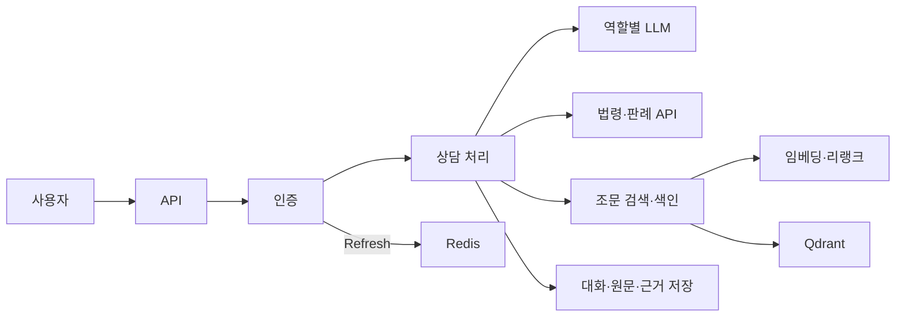

# MoleLaw Backend

**몰루로 묻고 법으로 답하다.** 법령 검색·근거 기반 AI 상담과 사용자별 대화 기록을 제공하는 Java 17 / Spring Boot 3.5 백엔드입니다.

기준일: **2026-10-26**, 현재 `dev` 작업 코드 기준입니다. 기능 구현과 실제 법률 품질·운영 검증은 구분합니다.

| 읽을 내용 | 문서 |
| --- | --- |
| 구현 기능·첫 질문·후속 질문 다이어그램 | [기능과 질문 처리 흐름](docs/project/features-and-question-flow.md) |
| 로그인·채팅방 생성 흐름 | [로그인](docs/auth/login-flow.md), [채팅방 생성·제목 변경](docs/chat/chat-room-management.md) |
| 현재 구현·제한 | [개발 현황](docs/project/development-status.md) |
| 사용자가 정할 정책 | [사용자 판단 대기](docs/decisions/README.md) |
| 이미 확정한 방향 | [확정 결정](docs/decisions/confirmed.md) |
| 앞으로 할 일·실행 순서 | [작업 계획](docs/plans/README.md) |
| 검증 범위·결과 | [검증 현황](docs/validation/validation-status.md) |
| 상세 사용법·설계 | [전체 문서](docs/README.md) |

문서는 기능별로 [인증·사용자](docs/auth/README.md), [상담·대화](docs/chat/README.md), [법령·판례·RAG](docs/law/README.md), [데이터베이스](docs/database/README.md), [코드·모델 구조](docs/architecture/README.md), [검증](docs/validation/README.md)으로 묶었습니다. [작업 계획](docs/plans/README.md)과 [사용자 결정](docs/decisions/README.md)은 별도로 관리합니다.

## 주요 기능

- 이메일·비밀번호 가입/로그인과 Google OAuth, 사용자 프로필 관리
- JWT 인증·상담방 소유권 검사, Redis Refresh 회전·재사용 탐지
- 최초 질문 분류·Qdrant 검색·충분성 판단·필요한 법령 수집·ETL·재검색·답변 생성
- 일반 법령 검색 전체 페이지 리랭크와 기준 미달 후보 수집 제외
- Qdrant 적재 후 포인트·출처·벡터 재조회 검증, 완료 세대만 검색
- 최초 근거 스냅샷·UUID 인용 검증, USER/BOT AES-256-GCM 저장
- 후속 상담의 MessageChatMemoryAdvisor와 최초 고정 근거 사용
- 후속 판례 실행계획·요청별 동의 확인·사건 식별어를 보존한 검색·본문 리랭크·실제 인용한 근거 누적
- 최초 SSE·NDJSON과 후속 NDJSON의 진행 단계·근거·임시 답변·완료·오류 전달
- local 전용 Swagger·ETL 테스트·AI Search 비교 API

AI Search는 별도 코드·모의 검증을 준비했으나 실제 API 404 원인은 미확인이고 재시도는 보류 중입니다. 기본 경로는 QDRANT이며 자동 대체하지 않습니다.

## 현재 아키텍처



위 그림은 서비스 구성입니다. 실행 순서와 분기는 [첫 질문·법령 확보·후속 질문·응답 마무리 다이어그램](docs/project/features-and-question-flow.md#첫-질문)을 따릅니다. 첫 질문은 실행 한도 안에서 수집·색인 검증·재검색을 반복합니다. 후속 검색 여부는 최신 메시지만으로 판단하며, 판례 외부 조회는 이번 요청의 동의가 있어야 실행합니다. 답변 작성은 같은 방의 대화 기록을 활용합니다.

## 현재 모델 배정

| 역할 | 모델 | 추론 수준 |
| --- | --- | --- |
| 질문 분석·후보 목록·본문 읽기 선택 | gpt-5.4-mini | low |
| 후속 판례 실행계획·검색어·본문 리랭크 | gpt-5.4-mini | low |
| 근거 충분성·추가 행동 판단 | gpt-5.4 | medium |
| 최초·후속 답변 | gpt-5.4-mini | medium |

역할별 환경변수와 완료 토큰 한도를 분리했습니다. 실제 모델 접근·옵션·법률 품질·비용 평가는 아직 남아 있습니다. 키워드 추출의 기존 OPENAI_CHAT_MODEL과 로컬 임베딩 모델은 별도입니다. [모델 설정](docs/architecture/role-chat-clients.md)을 따릅니다.

임베딩은 현재 KURE-v1·고정 revision·1024차원·float32, 서비스용 threaded HTTP 서버를 사용합니다. 실행 환경은 CPU 기본 구성과 선택적 CUDA override로 분리하고 장치·배치·자원 한도는 환경변수로 조정합니다. Ollama 모델 비교는 별도 실험입니다. [KURE 실행](docker/kure/README.md), [Ollama 실험](docker/ollama/README.md)을 구분하세요.

## 기술 구성과 구조

Java 17, Spring Boot 3.5.0, Spring AI 1.0.9, Gradle Wrapper, MySQL 8.4.11, Qdrant 1.19.1, Redis 7.4.11을 사용합니다. 테스트는 JUnit Jupiter·Mockito·Spring Security Test·H2와 선택 통합 검증으로 구성합니다.

```text
src/main/java/com/MoleLaw_backend/
  auth/       JWT·OAuth·CSRF·Refresh
  user/       사용자·계정·프로필
  chat/       상담방·메시지·답변·근거·메모리
  law/        법령·판례·수집·ETL·검색
  common/     공통 응답·예외·설정·AI 호출
src/main/resources/  설정·프롬프트·Flyway
src/test/            테스트·fixture
docker/              로컬 컨테이너·임베딩
postman/             HTTP 모의 계약·simulation
scripts/             실행 검증 스크립트
docs/                현재 계약·decisions·plans·archive
../MoleLaw_backend-experiments/  별도 실험 워크트리 (실험 브랜치)
```

코드 배치는 [domain-structure](.agents/skills/domain-structure/SKILL.md), 기여 기준은 [AGENTS.md](AGENTS.md)를 따릅니다. 실험 자료·컬렉션은 서비스 데이터와 분리합니다.

## 로컬 실행

JDK 17과 Linux containers 모드의 Docker Desktop을 준비합니다. 설정 파일이 없을 때만 복사하세요.

```powershell
if (!(Test-Path .env)) { Copy-Item .env.example .env }
if (!(Test-Path docker/.env.compose)) { Copy-Item docker/.env.compose.example docker/.env.compose }
docker compose -f docker/compose.yml --env-file docker/.env.compose config --quiet
docker compose -f docker/compose.yml --env-file docker/.env.compose up -d
.\gradlew.bat bootRun --args="--spring.profiles.active=local"
```

.env에 DB·Redis·OAuth·JWT·OC_KEY·OPENAI_API_KEY·CHAT_ENCRYPTION_KEY를 설정하고 Compose와 같은 서비스 비밀값을 일치시킵니다. 암호화 키는 무작위 32바이트의 Base64입니다. 비밀값을 커밋하거나 로그에 출력하지 마세요.

Qdrant RAG는 APP_LAW_VECTOR_ENABLED=true와 별도 임베딩 서버가 필요합니다. 서비스 KURE 실행은 [Docker 가이드](docker/README.md)를 따르세요. 코드 기본 포트 11436과 서비스 컨테이너 11437을 혼동하지 않도록 APP_LAW_VECTOR_EMBEDDING_BASE_URL을 지정합니다. 모델·.env 변경 후 서버를 재시작합니다.

local 주소는 API :8080, Swagger /swagger-ui.html, MySQL :3307, Qdrant HTTP/gRPC :6333/:6334, Redis :6379입니다. 기본 mysql 프로필은 MySQL·JPA validate, local은 mysql+qdrant·Swagger, test는 H2·모킹입니다. 운영에 local/test 프로필을 사용하지 않습니다. Flyway V1~V7 적용·오류 대응은 [MySQL 실행](docs/database/mysql-setup.md)을 따릅니다.

## 인증·API 사용

Access는 모든 프로필에서 최대 5분 stateless JWT입니다. Refresh는 Redis 해시·원자 회전·재사용 탐지·절대 7일 family이며 HttpOnly 쿠키로만 전달합니다. 로그아웃·비밀번호 변경 후 복사된 Access는 만료까지 유효합니다. [Access](docs/auth/stateless-access.md), [Refresh](docs/auth/refresh-rotation.md)를 참고하세요.

프론트는 먼저 GET /api/auth/csrf를 credentials와 함께 호출하고 JSON의 token을 X-XSRF-TOKEN 헤더로 보냅니다. 가입·로그인·재발급과 Bearer 요청을 포함한 상태 변경 요청에도 필요합니다. 운영 CSRF 쿠키는 HttpOnly이며 JSON 토큰을 사용합니다. 운영 Swagger는 비활성화합니다.

| 기능 | 경로 |
| --- | --- |
| CSRF·가입·로그인·재발급·로그아웃 | /api/auth/{csrf,signup,login,refresh,logout} |
| 내 정보·탈퇴·비밀번호·닉네임 | /api/users/me, /api/users/me/password, /api/users/me/nickname |
| 상담방 목록·최초 질문 | GET·POST /api/chat-rooms |
| 메시지 조회·후속 질문 | GET·POST /api/chat-rooms/{roomId}/messages |
| 방 삭제 | DELETE /api/chat-rooms/{roomId} |
| 방 제목 변경 | PATCH /api/chat-rooms/{roomId}/title |
| 법령 검색·질문 분석 검색 | GET /api/laws, POST /api/laws/search |
| 판례 목록·상세 | GET /api/precedents, GET /api/precedents/{id} |
| 키워드·무저장 답변 | POST /api/law-keywords, POST /api/legal-answers |

상담 요청은 {"content":"상담 질문"}, 법령 질문 분석·키워드·무저장 답변은 {"query":"법률 질문"}입니다. 실제 메서드·응답·인증·오류는 local OpenAPI와 [API 정리](docs/architecture/package-api-organization.md)를 확인하세요. 로컬 전용 ETL·검색 비교 경로는 [ETL](docs/law/law-etl-local.md), [AI Search 비교](docs/law/ai-search-comparison.md)에 있습니다.

## 빌드와 검증

```powershell
.\gradlew.bat test
.\gradlew.bat bootJar
# Docker 등 별도 준비가 필요한 선택 검증
.\gradlew.bat mysqlIntegrationTest
.\gradlew.bat redisIntegrationTest
.\gradlew.bat qdrantIntegrationTest
```

일반 테스트는 실제 모델·OpenLaw를 모킹하며 Docker·실 API 키 없이 실행합니다. 실제 저장소·임베딩·모델 품질은 각각 별도로 검증합니다. 최신 결과와 실행 구분은 [검증 현황](docs/validation/validation-status.md), 상세 방법은 [검증 계획](docs/plans/delivery-validation.md)을 따릅니다.

## 앞으로 할 일

현재는 복수 쟁점·지정 사건 검색·후속 답변의 품질과 실패 복구에 집중합니다. 실제 usage 기반 최종 예산 산출은 기능 안정화 후 진행합니다. 기준일·중단 복구·선택 공급자·운영 준비는 [작업 계획](docs/plans/README.md), 정책 선택은 [사용자 판단](docs/decisions/README.md)에서 관리합니다. 진행 상태와 답변 스트리밍은 구현돼 있습니다.

개발은 dev에서 진행합니다. 검증한 통합본을 main에 반영하며 EC2 배포는 main의 Deploy to EC2 수동 실행입니다. push만으로 배포하지 않습니다.

브랜치별 파일 관리와 갱신 방법은 [브랜치 작업 가이드](docs/project/branch-workflow.md)를 참고하세요.
