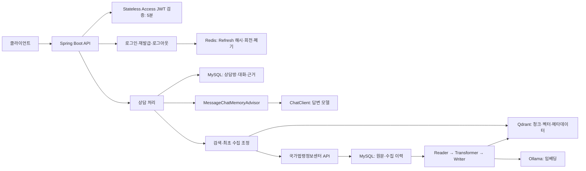

# MoleLaw Backend

**몰루로 묻고 법으로 답하다.** MoleLaw는 사용자의 법률 질문에 관련 법령과 판례 정보를 연결해 답변하고, 상담방에 대화를 저장하는 법률 검색·AI 상담 백엔드입니다.

현재 Java 17·Spring Boot 3.5·Spring AI 기반으로 백엔드를 재구축하고 있습니다. 법령 수집부터 벡터 검색, 대화 맥락 유지, 토큰 인증까지 역할을 분리하고 검증 가능한 구조로 바꾸는 것이 목표입니다.

> 이 README는 2026-10-14 기준입니다. 아래의 현재 구현과 재구축 계획을 구분해 읽어 주세요. Qdrant·Redis 컨테이너 구동이 애플리케이션 검색·인증 전환 완료를 의미하지는 않습니다.

## 주요 기능

- 이메일·비밀번호 회원가입과 로그인, Google OAuth 로그인
- 사용자별 상담방 생성·목록 조회·메시지 조회·삭제
- 최초 질문의 법령 유사도 검색·판례 목록 조회와 AI 답변 생성
- USER·BOT·INFO 구분과 메시지 암호화 저장
- JWT 인증과 상담방 소유권 검사
- local 프로필의 Swagger UI를 통한 API 확인 (운영 비활성화)

Kakao OAuth 설정은 별도 `kakao` 프로필로 분리되어 있습니다. 기본·로컬 실행에서는 Google 설정을 사용합니다.

## 현재 구현과 바뀔 구조

| 영역 | 현재 구현 | 재구축 방향 |
| --- | --- | --- |
| AI 호출 | Spring AI 1.0.9 ChatClient·EmbeddingModel 통합 | 상담·보조 호출 분리, Advisor와 구조화 답변·출처 검증 |
| 법령 수집 | 기존 상담 경로는 첫 페이지/fallback, 별도 내부 Tool은 페이지·정확명·ID·날짜·정렬 지원 | 최초 질문에서 다음 페이지·다른 법령 후보 수집, 이력·실패 재개 |
| 임베딩 | OpenAI 모델, MySQL 임베딩 테이블 저장 | Ollama 모델 비교 후 Spring AI ETL·Qdrant 색인으로 전환 |
| 검색 | 전체 임베딩 조회 후 코사인 유사도 직접 계산 | Qdrant 벡터 검색·필터·중복 제거·조문 맥락 확장 |
| 후속 상담 | 최초 assistant 답변과 현재 질문 전달 | MessageChatMemoryAdvisor로 채팅방 기록과 최초 원문 근거 전달 |
| Access | 5분 stateless JWT, HS256·issuer/audience·용도·버전·필수 claim·수명 검증 | 구현 완료, Redis 등록·조회·폐기 없음 |
| Refresh | Redis 해시·family·원자 회전·재사용 탐지·폐기·절대 7일 TTL, HttpOnly 쿠키 전용 | 운영 복구·호출 제한·세션 관리 확장 |

MySQL·Qdrant 프로필과 H2 테스트 구성, 공통 AI 호출, 기본 법령 수집 회귀 테스트는 구현되어 있습니다. **Access 5분 stateless + Redis Refresh**를 구현했습니다. Access는 Redis 없이 검증하고 Refresh 해시·회전·폐기는 Redis에서 관리합니다.

## 목표 아키텍처

다음 그림은 재구축 후 목표 구조입니다.



MySQL 원문은 기준 데이터이며 Qdrant 색인은 재생성 가능한 검색 데이터로 관리합니다. Redis 인증 상태와 Advisor 대화 메모리는 별개입니다. 상담방 conversationId와 로그인 sessionId도 구분합니다.

## 법령 ETL과 RAG 계획

Spring AI의 `DocumentReader → DocumentTransformer → QdrantVectorStore` 구조로 법령 자료를 읽고, 조문 구조를 보존해 나눈 뒤 임베딩·색인합니다. 법령 ID/MST, 조·항·호·목 경로, 원문 링크, 수집 시각과 내용 해시를 보존합니다. 안정적인 청크 ID와 색인 버전으로 중복·변경·삭제·재실행을 관리합니다.

**최초 질문**에서는 기존 색인을 검색하고, 근거가 부족하면 같은 검색 조건의 다음 페이지나 다른 법령 후보를 수집합니다. 새 자료를 ETL·색인한 뒤 재검색해 같은 질문의 답변에 반영합니다. 고정 2라운드 제한을 두지 않고 근거 확보, 탐색 소진, 설정한 시간·호출·임베딩 예산으로 종료합니다.

**후속 질문**에서는 Advisor가 채팅방 기록을 전달하고 최초에 저장한 근거 스냅샷으로 답변합니다. 추가 수집·색인·법령/판례 검색은 하지 않습니다. 기존 근거 밖의 새로운 쟁점은 한계를 설명하고 새 상담방에서 다루도록 안내합니다.

판례는 쟁점 기반 검색 후 상세 내용과 관련성을 검증한 자료만 채택할 계획입니다. 이전 assistant 답변이나 판례 제목만을 법률 원문 근거로 취급하지 않습니다. 최종 답변의 근거 ID·출처를 서버에서 검증한 후 성공한 대화 턴을 확정합니다.

## 법령 임베딩 비교 현황

긴 표 대신 [그래프와 정렬된 요약](evaluation/legal-retrieval/reports/chunk-experiments/overview.md)으로 모델·청크별 차이를 확인할 수 있습니다.

2026-10-16 기준 EmbeddingGemma·BGE-M3·KURE-v1의 300 / 500 / 700문자 청크 평가, 총 9개 구성을 완료했습니다. 서비스에 적용할 모델과 청크 크기는 아직 확정하지 않았습니다.

| 비교군 | 기본 벡터 차원 | 역할 |
| --- | --- | --- |
| BGE-M3 | 1,024 | 세 청크 평가 완료, 다국어 기준선 |
| EmbeddingGemma | 768 | 세 청크 평가 완료, 소형 기준선 |
| KURE-v1 | 1,024 | 세 청크 평가 완료, 한국어 추가 학습 모델 |
| qwen3-embedding:0.6b | 1,024 | 미실행 후속 후보 |

현재 실험은 주 법령 20개와 보충 근거의 원문 5,486개 단위, 질문 110개를 고정했습니다. 토큰 기준이 아닌 최대 300 / 500 / 700문자·중복 64문자 청킹입니다. 개발용 양성 30개에서 Recall@5를 1차 기준으로 사용하고 MRR·Recall@10·Hit@5·Complete@5·Precision@5·nDCG@5/10을 함께 봅니다. 음성은 분할별 5개로 별도 평가합니다.

원본 질문 비교의 개발 Recall@5 우선 후보는 BGE-M3 700문자(65.72%)이며, Gemma 700문자는 64.22%입니다. MRR은 KURE 500문자(0.6245), nDCG@5는 Gemma 700문자(0.5543)가 가장 높았습니다. 작은 표본의 탐색 결과이며, 공개된 held-out을 반복 튜닝에 사용하지 않습니다. 유사도 원시 점수는 모델 간 우열이나 정답 확률로 해석하지 않습니다.

[실행 안내](evaluation/legal-retrieval/README.md), [모델·청크 비교표](evaluation/legal-retrieval/reports/comparison.md), [유사도·지표 설명](evaluation/legal-retrieval/reports/similarity-and-metrics.md)에서 전체 결과를 확인할 수 있습니다. 모델 비교 지표는 오프라인 전수 코사인 검색 기준이며 생성 답변은 검증하지 않았습니다. 차원 축소와 토큰 기반 청킹은 후속 실험입니다.

Gemma·BGE-M3·KURE-v1의 300·500·700문자 벡터를 Qdrant의 실험 전용 컬렉션 9개에 적재했습니다. 모델별 청크 수는 각각 8,497·6,634·6,031개이며 전체 63,486개입니다. 대시보드에서 원문과 정보를 확인하고 스크립트로 검색·재색인·검증·삭제할 수 있습니다. [Qdrant 실험 안내](evaluation/legal-retrieval/reports/qdrant-lab/README.md)를 참고하세요.

세 모델 × 세 청크 크기의 [질문 정제·Qdrant 통합 비교](evaluation/legal-retrieval/reports/chunk-experiments/comparison.md)를 완료했습니다. 고정 질문 110개를 원본·정제로 9개 구성에 적용해 1,980개 실행 조합을 비교했고 검색 시간은 11,880회 측정했습니다. 질문 임베딩·LLM 정제·답변 생성 시간은 제외했으며, 무거운 추론과 측정은 리소스 간섭을 줄이기 위해 순차 실행했습니다.

정제 입력의 개발용 Recall@5는 KURE 300문자(75.17%)가 가장 높았습니다. Gemma는 세 크기 모두 72.00%, BGE-M3는 500문자(72.67%)가 해당 모델 안에서 가장 높았습니다. 원본 입력과 유리한 청크가 달라 모델·질문 입력 방식·청크를 함께 비교해야 합니다. 대화형 LLM이 작성한 고정 정제본을 재사용한 탐색 실험이며 자동 정제 API의 시간·비용이나 독립 블라인드 검증을 뜻하지 않습니다. 검증용 결과와 전체 MRR·nDCG·근거 전체 회수율은 통합 표에서 함께 확인할 수 있습니다. 기존 [700문자 상세 비교](evaluation/legal-retrieval/reports/query-rewrite-v1/comparison.md)도 보존했습니다.

모델별 토크나이저·질문/문서 입력 형식·실제 출력 차원을 확인합니다. 모델별 Qdrant 컬렉션을 분리하며 같은 차원이어도 서로 다른 모델 벡터를 섞지 않습니다. 답변 모델은 우선 외부 API를 유지하고 Ollama는 임베딩 후보로 도입합니다.

zero-shot RAG 기준선을 확보한 뒤 one-shot 답변 예시와 step-back 검색 전략을 각각 비교합니다. one-shot은 답변 예시 한 개를 넣는 방식이며 최종 답변 호출 횟수와는 다른 개념입니다.

## 역할별 에이전트 도입 계획

기본 ETL·RAG 이후 서버 오케스트레이터 아래 검색 계획·근거 검토·답변 역할을 순서대로 분리할 계획입니다. 인증·수집·ETL·예산·종료·출처 ID 검증·저장은 서버 코드가 담당하고, 모델은 검색어와 부족한 근거를 구조화해 제안합니다. 후속 상담은 Advisor와 최초 근거를 사용하며 검색 도구를 제공하지 않습니다.

초기 비교안은 검색 계획에 `gpt-5.4-mini / low`, 근거 검토·최초 답변에 `gpt-5.4-mini / medium`, 어려운 사례의 품질 비교에 `gpt-5.4 / medium`입니다. 최종 선정은 아니며 Spring AI 1.0.9의 옵션 호환성·검색/답변 품질·지연·비용을 검증한 뒤 결정합니다. Ollama 임베딩 비교와는 별도입니다. 상세 역할 계약은 [재구축 계획](docs/backend-rebuild-plan.md)을 참고하세요.

## 인증 보안 개선 계획

Access는 모든 프로필에서 최대 5분인 stateless JWT입니다. HS256 서명, 용도, `tokenVersion=3`, `iss=molelaw-auth`, `aud=molelaw-api`, 필수 claim과 iat/exp 수명을 검증합니다. Redis 등록·조회·폐기는 없습니다. 사용자 존재·권한은 기존 DB 조회로 확인합니다. 자세한 전환 계약은 [Access stateless 구현](docs/stateless-access.md)을 참고하세요.

현재 Access 검증은 Redis에 의존하지 않고, Refresh만 Redis 해시·회전·폐기로 관리합니다. 로그아웃·비밀번호 변경은 추가 재발급을 막지만 이미 발급된 Access는 만료까지 최대 5분 유효합니다. Redis 장애 시 기존 Access 검증은 유지하고 로그인·재발급·폐기는 오류로 처리합니다. 업무 DB 조회와 권한·CSRF 검사는 별개입니다. 이전 버전 Access는 거절합니다. 기존 r1 Refresh가 정상이라면 회전으로 새 Access를 받을 수 있으며, 구형 JWT Refresh·유실된 Refresh는 재로그인이 필요합니다.

Access는 **`sub=User.id`(사용자 고유키 문자열)**와 `tokenVersion=3`를 사용합니다. `user.id`는 기존 AUTO_INCREMENT 기본키를 사용하며 이메일·provider·닉네임을 claim에 넣지 않습니다. 가입·로그인·OAuth·재발급, principal과 사용자 조회를 ID 기반으로 통일했습니다. Refresh는 JWT 대신 선택자와 256비트 난수로 발급하며 Redis에 전체 토큰의 SHA-256 해시만 저장합니다. 기존 JWT Refresh는 거절하므로 재로그인해야 합니다. ID 사용과 별도로 API 권한·상담방 소유권을 검증합니다. 상세 계약은 [Refresh 회전 구현](docs/refresh-rotation.md)을 따릅니다.

토큰·payload 로그 제거, 공통 쿠키 정책, 명시적 CORS 허용 목록과 CSRF 보호를 적용했습니다. Refresh는 HttpOnly 쿠키로만 전달하며 로그인·재발급 JSON에는 Access만 포함됩니다. 매 재발급마다 Refresh를 회전하고 사용한 토큰 재사용은 해당 family를 폐기합니다. 로그아웃은 전달된 Refresh family를 폐기하고 인증 쿠키를 삭제합니다. 발급된 Access는 만료까지 유효합니다. 비밀번호 변경·탈퇴는 모든 Refresh family를 폐기합니다. 다른 로그인 family는 유지하며 상담 기록은 보존합니다.

Access 수명은 모든 프로필에서 **5분(300초)**입니다. 300초를 초과하는 설정은 거절합니다. `jwt.access-ttl`을 JWT와 Access 쿠키가 함께 사용합니다. Refresh family는 최초 로그인부터 **절대 7일**이며 회전·쿠키 갱신으로 연장하지 않습니다. 운영에 local/test 프로필을 사용하지 않습니다. `POST /api/auth/reissue`는 **Access 인증 없이** Refresh 쿠키와 CSRF 토큰으로 호출해 새 Access·Refresh를 발급합니다. Refresh 누락·만료·폐기·재사용은 401, Redis 오류는 503입니다. 다중 탭 재발급을 합치고 응답 유실 후 이전 Refresh를 자동 재시도하지 않아야 합니다. 후속 설계는 [인증·보안 실행 계획](docs/plans/auth-security.md)을 참고하세요.

## 기술 구성과 디렉터리

| 구분 | 구성 |
| --- | --- |
| 언어·빌드 | Java 17, Gradle Wrapper |
| 서버 | Spring Boot 3.5.0, Spring MVC, WebClient |
| 데이터·인증 | Spring Data JPA, Spring Security, OAuth2 Client, JJWT |
| AI | Spring AI 1.0.9, OpenAI ChatClient·EmbeddingModel |
| 로컬 인프라 | MySQL 8.4.11, Qdrant v1.19.1, Redis 7.4.11-alpine |
| 테스트·문서 | JUnit Jupiter, Mockito, Spring Security Test, H2, springdoc |

```text
src/main/java/com/MoleLaw_backend/
├── auth/                JWT·OAuth·CSRF·보안 설정
├── user/                사용자·계정·프로필 관리
├── chat/                상담방·메시지·상담 흐름
├── law/                 법령·판례·원문·검색·임베딩
└── common/              공통 응답·예외·설정·AI 호출
src/main/resources/      프로필 설정·프롬프트
src/test/                테스트·법령 응답 fixture
docker/                  Compose·환경변수 예제·검증 스크립트
docs/                    재구축 계획·기준선·보안 검토
```

도메인 안에 필요한 controller·service·entity·repository·dto 계층을 둡니다. 코드 배치와 의존 관계 기준은 [도메인 구조 스킬](.agents/skills/domain-structure/SKILL.md)을 따릅니다. 설계와 구현 상태는 [문서 안내](docs/README.md)에서 확인할 수 있습니다.

## 로컬 실행

JDK 17과 Linux containers 모드의 Docker Desktop을 준비합니다. 기존 환경변수 파일이 있으면 덮어쓰지 않고 필요한 항목만 추가합니다.

```powershell
# 저장소 루트에서 실행. 두 대상 파일이 없을 때만 복사합니다.
Copy-Item .env.example .env
Copy-Item docker/.env.compose.example docker/.env.compose
```

`.env`에는 DB·OAuth·OpenAI·OpenLaw·JWT 설정을, `docker/.env.compose`에는 MySQL 비밀번호·Qdrant API 키·Redis 비밀번호를 입력합니다. 같은 서비스의 비밀값은 두 설정에서 일치시킵니다. Redis 비밀번호는 32자 이상의 무작위 영문·숫자·밑줄·하이픈을 사용합니다. 비밀값은 커밋하지 않습니다.

```powershell
docker compose -f docker/compose.yml --env-file docker/.env.compose config --quiet
docker compose -f docker/compose.yml --env-file docker/.env.compose up -d
.\gradlew.bat bootRun --args="--spring.profiles.active=local"
```

local 프로필의 주소는 백엔드 `http://localhost:8080`, Swagger `http://localhost:8080/swagger-ui.html`, MySQL `127.0.0.1:3307`, Qdrant HTTP/gRPC `6333/6334`, Redis `6379`입니다.

| 프로필 | 현재 동작 |
| --- | --- |
| 기본 / mysql | MySQL @Primary 데이터소스, 스키마 validate, Swagger UI·OpenAPI 비활성화 |
| local | mysql + qdrant, Flyway 초기화 후 스키마 validate, SSL 비활성화, Swagger 활성화 |
| test | H2·더미 인증·모델 모킹, 외부 저장소 없이 테스트 |
| kakao | 필요한 경우 명시적으로 활성화하는 OAuth 설정 |

가입·로그인·재발급·OAuth·삭제에 공통 쿠키 정책을 적용합니다. 운영 기본값은 Secure=true·SameSite=None이며 local/test는 Secure=false·SameSite=Lax입니다. Access/Refresh는 모든 환경에서 HttpOnly이고 Path는 각각 `/`, `/api/auth`이며, 이전 Path=/ Refresh 쿠키는 발급·삭제 시 정리합니다. Ollama 애플리케이션 연동은 아직 없습니다. 준비 상태 검사·자원 예산·LAN 연결·데이터 보존 정책은 [로컬 인프라 가이드](docker/README.md)를 따릅니다.

Redis 연결은 `.env`의 `REDIS_HOST`, `REDIS_PORT`, `REDIS_PASSWORD`, `REDIS_DATABASE`, `REDIS_SSL_ENABLED`로 설정합니다. 로컬 비밀번호는 `docker/.env.compose`와 일치시킵니다. 연결·명령 제한 시간은 각각 2초입니다. Redis 유실에도 기존 Access는 만료까지 유효하지만 Refresh가 유실되면 재로그인해야 합니다. 미등록 Refresh를 자동 복원하지 않습니다.

로컬 키·TTL 모니터링은 선택적 Redis Insight를 사용합니다. 접속 주소는 `http://localhost:5540`이며 실행 방법은 [로컬 모니터링 안내](docker/README.md#redis-insight-로컬-모니터링)를 참고하세요.

Swagger UI와 OpenAPI는 공통 설정에서 비활성화하고 문서 경로 접근도 차단합니다. `local`에서 개발용으로 활성화하며 `test`는 문서 검증용 예외입니다. 운영 배포에는 local/test 프로필을 사용하지 않습니다.

## 빌드와 검증

```powershell
.\gradlew.bat test
.\gradlew.bat clean build
.\gradlew.bat bootJar
# Docker 필요. 기존 개발 DB 대신 임시 MySQL 8.4 컨테이너로 검증합니다.
.\gradlew.bat mysqlIntegrationTest
# 실행 중인 로컬 Redis 필요. 일반 test/CI에서는 제외됩니다.
.\gradlew.bat redisLiveTest
# Docker의 독립 Redis에서 Refresh 원자 회전·TTL·폐기·장애 검증
.\gradlew.bat redisIntegrationTest
powershell -NoProfile -ExecutionPolicy Bypass -File docker/verify.ps1
```

Gradle 테스트는 실제 모델 호출을 모킹하며 Docker·실제 API 키 없이 실행할 수 있습니다. H2 테스트는 실제 MySQL 통합 검증을 대체하지 않습니다. `verify.ps1`은 실행 중인 컨테이너의 MySQL 쿼리, Qdrant 인증·임시 벡터 검색, Redis 인증·임시 키 쓰기·TTL·삭제를 검사합니다.

2026-10-14 일반 테스트 148개·실제 Redis 회전 테스트 11개·MySQL 통합 테스트 2개와 JAR 생성을 통과했습니다. 일반 테스트는 대체 저장소·모킹으로 Docker 없이 실행하며 `redisIntegrationTest`는 독립 Redis에서 TTL·동시 소비·재사용/폐기·장애를 검증합니다. Access Redis 저장소와 `redisLiveTest`는 제거했습니다. 최신 Access 검증은 [구현 문서](docs/stateless-access.md)를 따릅니다. ETL·Advisor·실제 모델 품질 검증은 후속 구현 범위입니다.

## 주요 API

| 메서드·경로 | 설명 |
| --- | --- |
| GET /api/auth/csrf | CSRF 쿠키 발급 및 JSON 토큰 조회 (Access 인증 불필요) |
| POST /api/auth/signup | 회원가입: 200 성공 JSON과 JWT 쿠키 |
| POST /api/auth/login | 로그인 |
| GET /api/auth/me | 내 정보 조회 |
| POST /api/auth/reissue | Access 없이 Refresh 쿠키 + CSRF 토큰으로 Access/Refresh 회전 |
| POST /api/auth/logout | 로그아웃 |
| GET /api/chat-rooms | 내 상담방 목록 |
| GET /api/chat-rooms/{roomId} | 상담방 메시지 조회 |
| POST /api/chat-rooms/first-message | 상담방 생성과 최초 질문 |
| POST /api/chat-rooms/{roomId}/messages | 후속 질문 |
| DELETE /api/chat-rooms/{roomId} | 상담방·메시지 삭제 |

질문 입력은 `{"content":"상담 질문"}`이며 최초 응답은 상담방 ID와 메시지 목록, 후속 응답은 BOT 메시지입니다. 현재 요청·응답 계약은 local Swagger에서 확인할 수 있습니다. [재구축 기준선](docs/backend-baseline.md)은 변경 전 동작 기록입니다. 장시간 최초 질문 응답 방식은 후속 구현 범위입니다. Refresh 회전·JSON 제거·오류 전환은 [현재 인증 계약](docs/refresh-rotation.md#프론트-api-계약)을 따릅니다.

### 회원가입과 CSRF 전달 계약

회원가입 요청은 `{"email":"user@example.com","password":"Example-password-123!","nickname":"두더지"}`입니다. 성공 시 HTTP **200**, `Content-Type: application/json`, 두 JWT의 `Set-Cookie`와 다음 본문을 반환합니다. 기존 302 및 `/Main` 리다이렉트는 제거했으며 화면 이동은 프론트에서 처리합니다.

```json
{"success":true,"data":"회원가입 되었습니다."}
```

1. 인증 없이 `GET /api/auth/csrf`를 호출합니다. 응답은 `{"token":"<csrf-token>","headerName":"X-XSRF-TOKEN"}`이며 `XSRF-TOKEN` 쿠키와 `Cache-Control: no-store`를 함께 받습니다.
2. 해당 쿠키를 유지하고 JSON의 `token`을 `X-XSRF-TOKEN` 헤더에 넣어 POST·PUT·PATCH·DELETE 요청을 보냅니다. 가입·로그인·재발급·로그아웃과 Bearer 인증 요청에도 필요합니다. 교차 Origin 프론트는 조회와 후속 요청 모두 `credentials: "include"`를 사용합니다.
3. 운영 CSRF 쿠키는 HttpOnly이므로 JavaScript에서 쿠키를 읽지 않고 JSON 토큰을 사용합니다. local/test에서는 Swagger 자동 처리를 위해 CSRF 쿠키를 읽을 수 있으며, Swagger에서 CSRF 조회 후 헤더에 자동 적용합니다. Access/Refresh 쿠키는 계속 HttpOnly입니다.

교차 Origin 요청은 `CORS_ALLOWED_ORIGINS`의 명시적 허용 목록(미설정 시 `FRONTENDURI`)에 포함되어야 합니다. CSRF 누락·불일치 또는 허용되지 않은 Origin은 403으로 거절하며, Origin 헤더가 없어도 CSRF 검증은 적용됩니다. 보안 필터의 403 본문은 공통 `ApiResponse` JSON 형식을 보장하지 않습니다.

## 다음 단계

1. 기준선·권한·인증 보안 점검과 스키마 준비
2. Spring AI ETL·다중 페이지 수집·Ollama 임베딩 비교
3. 구현된 stateless Access·Redis Refresh의 운영 영속화·복구·호출 제한 검증
4. Qdrant 검색·최초 근거 스냅샷·판례 검증 연결
5. Advisor 기반 후속 상담과 출처 검증
6. 검색·답변 품질 비교와 기존 구현 정리
7. 서버 오케스트레이터와 검색 계획·근거 검토 역할의 단계적 도입·모델별 추론 수준 평가

상세 작업 순서·완료 조건·미정 정책은 [백엔드 재구축 계획](docs/backend-rebuild-plan.md)에 관리합니다. JWT에 상담방 목록을 넣는 방안은 검토 단계이며 현재 토큰 claim에 추가하는 것으로 확정하지 않았습니다.

## 관련 문서

- [백엔드 재구축 계획](docs/backend-rebuild-plan.md)
- [개발 인수인계](docs/development-handoff.md)
- [법령·판례 Tool 사용 계약](docs/legal-api-tools.md)
- [RAG·ETL 상세 계획](docs/plans/rag-etl.md)
- [인증·보안 실행 계획](docs/plans/auth-security.md)
- [오케스트레이션·모델 계획](docs/plans/orchestration-models.md)
- [구현·검증 계획](docs/plans/delivery-validation.md)
- [JWT 인증 보안 검토](docs/jwt-security-review.md)
- [재구축 전 동작 기준선](docs/backend-baseline.md)
- [로컬 인프라 실행·검증 가이드](docker/README.md)
- [CPU Ollama 임베딩 테스트 이미지](docker/ollama/README.md)
- [기여 가이드](AGENTS.md)

`main`은 검증한 최신 통합본, `dev`는 기능 통합·테스트 브랜치로 사용합니다. `dev` push와 `dev`/`main` 대상 PR은 외부 API 키 없이 테스트·JAR 패키징을 실행합니다. EC2 배포는 `Deploy to EC2`를 main에서 수동 실행하며 push만으로 배포하지 않습니다. [개발 인수인계](docs/development-handoff.md)에 브랜치 운영·스키마·검증·후속 작업을 정리했습니다. 새 Redis 인증·ETL·Ollama 연동의 운영 배포 구성은 별도 준비가 필요합니다.
