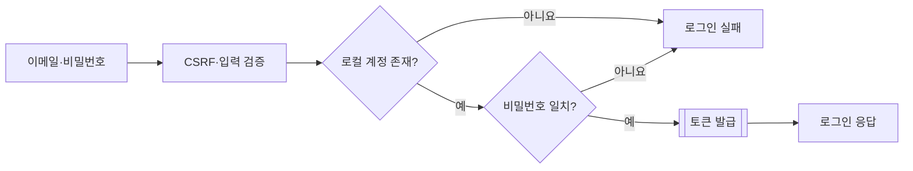
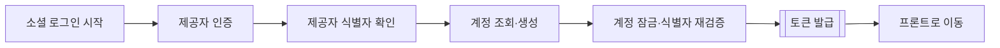
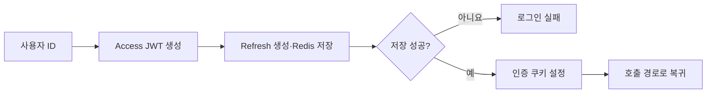

# 로그인 흐름

현재 코드 기준이다. 이메일 로그인과 소셜 로그인을 나누고, 공통 토큰 발급은 별도 그림으로 표시한다. 각 단계의 검증·저장소 오류는 로그인 실패로 종료한다.

## 이메일 로그인

- `POST /api/auth/login`은 이메일·`local` provider로 계정을 조회하고 잠근다. 비밀번호는 저장 해시와 비교하며 공백을 제거하지 않는다.
- CSRF는 먼저 `GET /api/auth/csrf`로 발급받고 쿠키와 `X-XSRF-TOKEN` 헤더를 함께 보낸다.
- 성공은 HTTP 200이다. Access는 JSON과 쿠키에, Refresh는 HttpOnly 쿠키에만 전달한다. 이메일이 같아도 소셜 계정과 자동 연결하지 않는다.

## 소셜 로그인

등록된 OAuth 제공자를 사용한다. 계정은 provider·subject로 식별하며 비밀번호를 만들지 않는다. 콜백 검증 실패나 토큰 발급 실패는 프론트 성공 이동으로 처리하지 않는다.

## 공통 토큰 발급

Access는 최대 5분이며 요청마다 Redis에서 조회하지 않는다. Refresh 상태는 Redis에서 회전·재사용 탐지·폐기를 관리한다. 토큰 값은 URL에 넣지 않는다. 자세한 정책은 [Access](stateless-access.md), [Refresh](refresh-rotation.md)를 따른다.

[기능·질문 처리 흐름](../project/features-and-question-flow.md) · [인증 문서](README.md)
