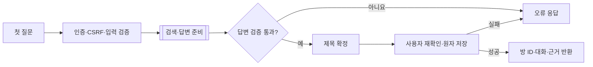
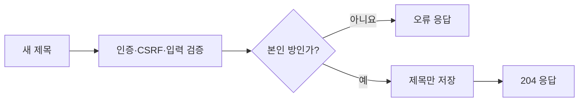

# 채팅방 생성과 제목 변경

## 채팅방 생성



- `POST /api/chat-rooms`에 `{"content":"상담 질문"}`을 보낸다. 빈 방부터 생성하지 않으며 첫 답변을 준비한 뒤 저장한다.
- 검색·답변 준비는 [첫 질문 흐름](../project/features-and-question-flow.md#첫-질문)의 저장 전 단계다. 충분한 근거가 있으면 외부 수집·ETL을 생략한다.
- 제목은 질문 분석 결과를 우선 사용하며, 없으면 기존 키워드 분석의 요약을 사용한다.
- 사용자 존재를 다시 확인한 뒤 방·최초 근거·암호화된 USER/BOT을 한 트랜잭션으로 저장한다. 실패 시 방·대화는 남기지 않는다. 앞서 확보한 법령 원문·완료 색인은 재사용을 위해 유지할 수 있다.
- 스트리밍은 `/api/chat-rooms/stream` 또는 `/api/chat-rooms/ndjson`을 사용한다. 저장 성공 뒤 `completed`를 반환한다. 무저장 `/api/legal-answers` 계열은 방을 만들지 않는다.

## 제목 변경



```http
PATCH /api/chat-rooms/42/title
Content-Type: application/json
X-XSRF-TOKEN: <csrf-token>

{"title":"보증금 반환 상담"}
```

앞뒤 공백을 제거한 제목은 Unicode 1~255자여야 한다. 본문 없는 204가 성공이며, 이후 목록 조회에 변경된 제목이 반영된다. 메시지·근거·생성 시각과 AI 호출에는 영향이 없다. 잘못된 제목은 400, 인증 누락은 401, 타인 방·CSRF 실패는 403, 없는 방은 404다.

[기능·질문 처리 흐름](../project/features-and-question-flow.md) · [상담 문서](README.md)
