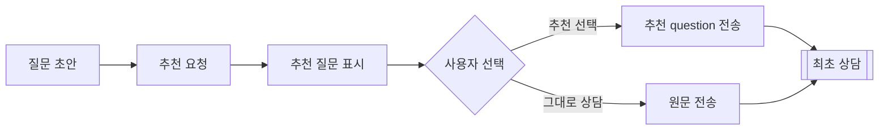

# 최초 상담 추천 질문

사용자가 작성한 초안으로 선택 가능한 질문 방향을 제공한다. 프론트의 추천 버튼·선택 동작은 별도 구현하며, 기존 최초 상담 API는 그대로 사용한다.

## 흐름



추천은 상담 시작 전의 선택 기능이다. 추천 요청만으로 방·메시지를 생성하지 않으며 검색·ETL·임베딩·판례 조회도 실행하지 않는다. 이전 대화나 방 근거를 읽지 않는다. 법률 답변이나 사실 확인 기능이 아니다.

## 추천 요청

```http
POST /api/legal-answers/suggestions
Content-Type: application/json
X-XSRF-TOKEN: <csrf-token>

{"query":"시공 하자와 관리 소홀이 함께 사고를 일으킨 경우 책임이 궁금합니다."}
```

Access 쿠키 또는 Bearer와 CSRF 토큰이 필요하다. 쿠키를 사용하는 브라우저 요청은 `credentials: "include"`를 적용한다. `/api/auth/csrf`의 JSON 토큰을 헤더로 보낸다. 초안은 공백이 아닌 Unicode 최대 2000자·UTF-8 최대 32KiB다.

```json
{
  "suggestedQuestions": [
    {
      "id": "suggestion-1",
      "label": "공동책임 기준",
      "question": "시공 하자와 관리 소홀이 함께 사고를 일으킨 경우 책임이 궁금합니다.\n\n위 상황에서 공동책임을 인정하는 일반 기준을 설명해 주세요."
    }
  ]
}
```

## 프론트 연결

1. 사용자가 초안을 작성하고 추천을 요청하면 이 API를 호출한다. 매 타이핑마다 자동 호출하지 않는다.
2. `label`을 선택 버튼으로 표시한다. 응답의 `id`는 현재 목록의 표시용이며 다른 요청에서 실행하거나 조회하는 키가 아니다.
3. 선택하면 `question` 전체를 `{"content":"선택한 question"}`으로 기존 `POST /api/chat-rooms`에 전송한다. 스트리밍은 `/api/chat-rooms/ndjson` 또는 `/api/chat-rooms/stream`을 사용한다.
4. 선택하지 않거나 추천 요청이 실패해도 원문을 기존 상담 API로 전송할 수 있다.

추천 선택은 외부 판례 검색 동의가 아니다. 추천 항목을 HTML로 실행하지 않고 텍스트로 표시한다. 전송 중 중복 클릭과 자동 재시도는 프론트에서 막는다.

## 생성·검증 규칙

- 별도 Builder/ChatClient를 사용하며 대화 Advisor·Tool은 붙이지 않는다. 기본 모델은 mini/low이며 완료 토큰 한도는 2048이다.
- LLM은 최대 3개의 짧은 `label`과 `focus`만 제안한다. 서버가 원문 + 줄바꿈 + 추천 방향으로 실제 질문을 구성하므로 원문 사실·복수 쟁점을 생략하지 않는다.
- 라벨 최대 40자, 추천 방향 최대 300자다. 조합 결과도 기존 상담의 Unicode 2000자 한도를 검사한다. 남은 길이가 32자 미만이면 모델을 호출하지 않고 원문 그대로 질문하는 항목 1개를 반환한다.
- JSON Schema와 서버 검증으로 필드·개수·길이·중복을 검사한다. 모델이 ID·실행 권한·검색 동의를 반환하는 것은 허용하지 않는다.
- 원문 보존은 서버가 보장한다. 추천 방향의 의미적 적합성·사실을 추가하지 않는 모델 품질은 별도 평가 대상이다.

설정은 `APP_AI_QUESTION_SUGGESTION_MODEL`, `APP_AI_QUESTION_SUGGESTION_REASONING_EFFORT`, `APP_AI_QUESTION_SUGGESTION_MAX_COMPLETION_TOKENS`를 사용한다. 기존 답변·검색 모델 설정과 분리한다.

## 실패·검증

입력 오류는 400, 인증 누락은 401, CSRF·Origin 실패는 403, 모델 호출·출력 검증 실패는 `500 GPT_API_FAILURE`다. 실패 시 상담은 생성하지 않는다.

기본 테스트는 모델을 모킹해 보안·무저장·원문 보존·길이·중복·실패를 검증한다. `.\gradlew.bat initialQuestionSuggestionSimulationTest`는 [Postman 실행 안내](../../postman/simulations/question-suggestions.context.md)의 모의 모델과 실제 HTTP 직렬화를 검증한다. 유료 모델의 추천 품질·프론트 클릭 동작 검증과는 구분한다.

[채팅방 생성](chat-room-management.md) · [전체 질문 처리](../project/features-and-question-flow.md)
