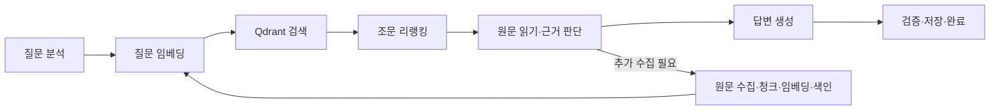

# 백엔드·DB·RAG 부하 테스트 계획

기준일: 2026-10-29. 상태: **조회·MySQL·Redis·Refresh API의 부하 및 장애·복구 검증 완료, RAG 미실행**.
처음이라면 [테스트 도구와 입문 안내](../testing/README.md)를 먼저 읽는다. 진행 상태는 아래 표 한 곳에서 관리한다.

추가 결과: [MySQL 직접 부하](../testing/mysql-capacity.md)와
[Redis·Refresh API 검증](../testing/redis-performance.md)을 완료했다. 상세 범위는 각 보고서를 따른다.
Refresh API는 동일 토큰 경쟁·재사용·응답 유실·Redis 장애 이후 토큰 상태까지 확인한다.

## 목표와 범위

일반 API와 RAG 상담의 성공 처리량·지연·오류를 측정하고 병목을 구분한다.
측정값은 해당 데이터·장비·모델·설정·부하 패턴에만 유효하다. 임의의 “최대 동시 사용자” 수치를 미리 정하지 않는다.
현재 문서는 도구 설치, 유료 호출, 운영 환경 부하, 데이터 삭제를 실행하지 않는다.

## 현재 구성에서 주의할 점

- 백엔드는 Spring Boot·MySQL·Redis, 검색은 Qdrant와 KURE 임베딩을 사용한다. 모델·주소·CPU/GPU 설정은 실행 환경에서 확인해야 한다.
- [조문 리랭커](../law/article-reranking.md)는 설정에 따라 활성화된다. 기본 후보 50개·최종 최대 15개이며 실제 실행값을 결과에 기록한다.
- KURE 임베딩과 cross-encoder는 추론 잠금·유한 대기열을 공유한다. 각각의 단독 시험 뒤 혼합 요청으로 간섭을 확인한다.
- 최초 상담은 기존 색인 검색뿐 아니라 추가 원문 수집·임베딩·색인을 수행할 수 있다. 두 경로를 분리한다.
- 후속 상담은 기존 방의 근거를 재사용하며 최초 법령 수집과 동일한 부하가 아니다. 동의한 판례 검색도 별도 시나리오로 둔다.
- 기존 smoke·통합 테스트 시간은 성능 기준으로 사용하지 않는다. 실제 호출 경로와 계측 유무는 구현 단계에서 코드와 대조한다.

## 단계별 실행 계획

| 단계 | 할 일 | 완료 조건 | 상태 |
| --- | --- | --- | --- |
| LT01 환경 분리 | 장비·자원 제한 기록, 전용 데이터·계정·대상 주소 준비 | 테스트 대상과 변경 범위, 외부 호출 여부를 명시 | 진행 중. 전용 최소 환경·비밀값·MySQL V8·[조회용 합성 사용자 20명/200방/4,000메시지](../testing/test-data.md) 준비·API 검증 완료. 개발 환경 중지·볼륨 보존. RAG 데이터·환경 미완료 |
| LT02 최소 계측 | API·JVM·Hikari·DB·모델 대기/추론 시간 수집 | 요청 1건과 서버 지표를 같은 시간축에서 확인 | API/DB/컨테이너와 [Qdrant·KURE 요청/대기/추론 계측](../testing/rag-monitoring.md) 연결. 전체 RAG 구간 계측은 후속 |
| LT03 첫 Locust 실습 | 조회 API 1개, 사용자 1명부터 실행 | 인증·CSRF·응답 검증·결과 저장 성공 | 완료. [1명·1분 결과](../testing/first-load-test.md): 목록/메시지 조회 18회, 전체 22회·실패 0. CSV/HTML·Prometheus 관측 저장 |
| LT04 일반 API | 방 목록·메시지 조회·저장을 각각/혼합 실행 | 성공 처리량과 DB 대기 관계를 설명 | 조회 탐색 완료. [2~2,048 VU·512 VU 지속 결과](../testing/read-capacity.md), 로그인 집중·게이트웨이 제한·CPU 포화 구분. 쓰기/혼합 후속 |
| LT05 RAG 구성요소 | 임베딩·벡터 검색·리랭커·원문 조회를 분리 | 입력 크기·동시성별 지연과 실패 분류 확보 | 관측·실제 모델 smoke 및 [고정 원문/1,000개 코퍼스/길이별 입력 준비](../testing/rag-dataset.md) 완료. 실제 부하·입력 크기·배치별 성능 측정은 다음 단계 |
| LT06 검색 파이프라인 | 실제 검색·DB, 질문 분석/답변 모델 등 외부 호출은 대역 사용 | 검색 처리량과 대기열, 호출 증폭을 설명 | 미착수 |
| LT07 실제 전체 상담 | 제한된 실 외부 호출, 최초·후속·판례 흐름 분리 | 첫 답변·완료 시간, 비용·제공자 제한까지 기록 | 미착수 |
| LT08 DB 기준·지속 시험 | sysbench와 실제 SQL 분석, 장시간·혼합 부하 | 포화·회복·누적 메모리와 병목 보고서 작성 | MySQL 200만 행 읽기·혼합·행 경합, Redis 명령·실제 Lua·OOM 회복 및 Refresh API 장애 검증 완료. 장시간 soak·실제 업무 SQL 튜닝은 후속 |

LT07의 실 호출 전에는 대상·실행 시간·동시성·비용 상한을 정한다. LT08의 sysbench는 테스트 전용 스키마에만 실행한다.

## RAG를 나누어 측정하는 방법



위 그림은 측정 구간 안내다. 실제 반복·병렬·후속 분기는 [질문 처리 흐름](../project/features-and-question-flow.md)을 따른다.

| 시험 | 입력·분리 방법 | 기록할 항목 |
| --- | --- | --- |
| 임베딩 단독 | 고정 텍스트, 길이·배치 크기별 직접 요청 | 대기 시간, 추론 시간, 벡터 수/초, 거부·timeout |
| Qdrant 단독 | 사전 생성 벡터로 실제 필터·그룹 검색 재현 | 데이터/벡터 수, 검색 지연, 반환 조문 수, CPU·I/O |
| 리랭킹 단독 | 같은 질문과 후보 세트, 후보 수·길이를 변경 | 후보 수, 쌍별 입력 길이, 대기·추론 시간, 오류 |
| 검색 통합 | 실제 KURE·Qdrant·MySQL, 외부 모델/수집은 통제 | 검색 1회와 상담 1건의 시간, 단계별 호출 횟수 |
| 검색+색인 혼합 | 독립 검색과 신규 법령 적재를 동시에 실행 | 임베딩·리랭커 자원 경쟁, 검색 지연 증가, 색인 처리량 |
| 전체 상담 | 실제 모델과 검색·저장을 연결 | 최초 answer_delta, completed, 토큰·비용·오류 단계 |

단계별 trace/span으로 요청·반복 횟수를 연결한다. HTTP 왕복 시간에는 네트워크·대기·추론이 섞이므로 모델 서버 내부 계측으로 구분한다.
병렬 구간과 재시도 때문에 단계별 p95의 합은 전체 p95가 아니다. 한 상담에서 늘어나는 임베딩·검색·LLM 호출 수도 기록한다.
질문 원문·인증값을 지표 label로 사용하지 않고 run ID·합성 질문 ID로 연결한다.

## 데이터와 시나리오

첫 기능 확인용 합성 질문 10개를 준비하고, 본 측정 전에는 길이·분야·경로를 구분한 고정 질문 세트로 확장한다.
각 질문에는 ID, 예상 경로, 검토한 정답 근거, 질문 길이를 둔다. 개인정보가 있는 실제 상담은 사용하지 않는다.

| 시나리오 | 데이터 조건 | 목적 |
| --- | --- | --- |
| 일반 조회 | 사용자·방·메시지 수 고정 | AI와 무관한 백엔드/DB 기준 |
| 기존 색인 최초 상담 | 동일 MySQL·Qdrant 스냅샷 | 검색·생성 성능 |
| 신규 수집 최초 상담 | 매 반복 전 독립된 초기 데이터 | 수집·ETL 비용; 두 번째 실행의 재사용과 분리 |
| 후속 상담 | 사용자별 독립 방과 같은 대화 길이 | 기존 근거 재사용 비용 |
| 판례 동의 상담 | allowCaseSearch 명시, 동의 전 호출 0회 확인 | 판례 수집·본문 처리 비용 |
| 반복/새 질문 | 반복 비율과 캐시 상태 기록 | 캐시 영향을 분리 |

문서·청크·벡터 수, MySQL 행 수, 질문 길이, 리랭크 후보 수, 컨텍스트·출력 토큰 수를 결과에 남긴다.
모델 로드 직후와 워밍업 후를 구분한다. OS/DB 캐시를 임의 삭제하지 않고 초기 상태·재사용 조건을 명시한다.
품질은 정답 근거 포함률·출처 유효성으로 함께 비교한다. 후보를 줄여 빨라졌다면 동일 질문의 근거 누락 여부도 확인한다.

## 첫 실행의 수치 예시와 중단 조건

아래는 **외부 유료 호출 없는 격리 환경의 시작 제안**이며 실행 전 장비에 맞게 확정한다.

1. 사용자 1명으로 1분 기능 확인. 스트림은 완료까지 충분한 제한 시간을 두고, 진행 이벤트만 받고 성공으로 처리하지 않는다.
2. 워밍업 후 사용자 1 → 2 → 4명, 각 3분 측정. 사용자당 생각 시간은 2~5초로 고정한다.
3. 문제가 없을 때만 8명 이상으로 확대한다. 모델 응답이 길면 측정 시간을 늘려 완료 표본을 확보한다.
4. 같은 조건으로 3회 반복한다. 표본 수·측정 시간·워밍업 제외 범위를 적고 소수 표본의 p99를 과신하지 않는다.
5. 한계 근처에서 정상 부하로 낮춘 뒤 대기열·지연이 회복되는지 확인한다. 이후에만 급증·30분 이상 지속 시험을 설계한다.

오류율 5% 이상이 30초 지속, 모델/DB 메모리 부족·재시작, 완료 없는 대기 지속, 사전 비용 상한 도달 시 신규 요청을 중단하는 보호 장치를 구현한다.
수치는 초기 보호 기준이며 서비스 합격 기준과 다르다. 도구의 사후 threshold 판정만으로 자동 중단된다고 가정하지 않는다.
진행 중인 요청의 종료·취소·DB 반영 여부를 확인하고, 종료 직전 미완료 요청도 별도로 집계한다.
부하 발생기의 CPU·메모리·네트워크도 수집한다. 같은 PC에서 실행한 결과는 자원 경쟁의 한계를 명시한다.

## 결과 기록 양식과 판정

```text
실행 ID / 날짜 / 커밋 / 도구 버전:
장비·컨테이너 CPU·메모리 / CPU·GPU / 모델·revision:
대상 주소(비밀값 제외) / 시나리오 / 실제·대역 서비스:
DB·벡터 데이터 규모 / 초기 상태 / 질문셋 버전:
동시 사용자 / 생각 시간 / 워밍업 / 측정 시간 / 반복 번호:
시도·성공·실패·미완료 수 / HTTP RPS / 완료 상담 수·분:
전체 p50·p95·p99 / 첫 answer_delta / completed:
단계별 호출 수·시간 / 대기열 / CPU·메모리·I/O / Hikari 대기:
오류 분류(인증·429·timeout·검색·인용·저장·연결 종료):
품질 표본·근거 포함률 / 외부 호출·토큰・비용:
중단 여부 / 회복 시간 / 원본 결과 파일 / 해석과 제한:
```

합격 기준은 첫 기준 측정 후 일반 조회·검색·전체 상담별로 정한다. 성공 처리량·지연·오류율·품질을 함께 평가한다.
초기 결과로 운영 수용량을 보장하지 않는다. 결과 파일은 비밀값을 제거한 뒤 공유하며 세부 상담 원문은 저장하지 않는다.

## 다음 구현에서 제공할 것

도구 버전과 Windows/Docker 실행 방식을 확정하고, 설치 확인 → 사용자 1명 실행 → 결과 해석 → 중단 순서의 명령 안내를 추가한다.
Locust 시나리오, SSE/NDJSON 파서, 모델 계측, 관측 Compose, 테스트 데이터 준비·정리 스크립트는 후속 구현 대상이다.
현재 단계에서는 계획과 도구 설명의 링크·내용만 확인하며 실 부하 결과로 기록하지 않는다.
