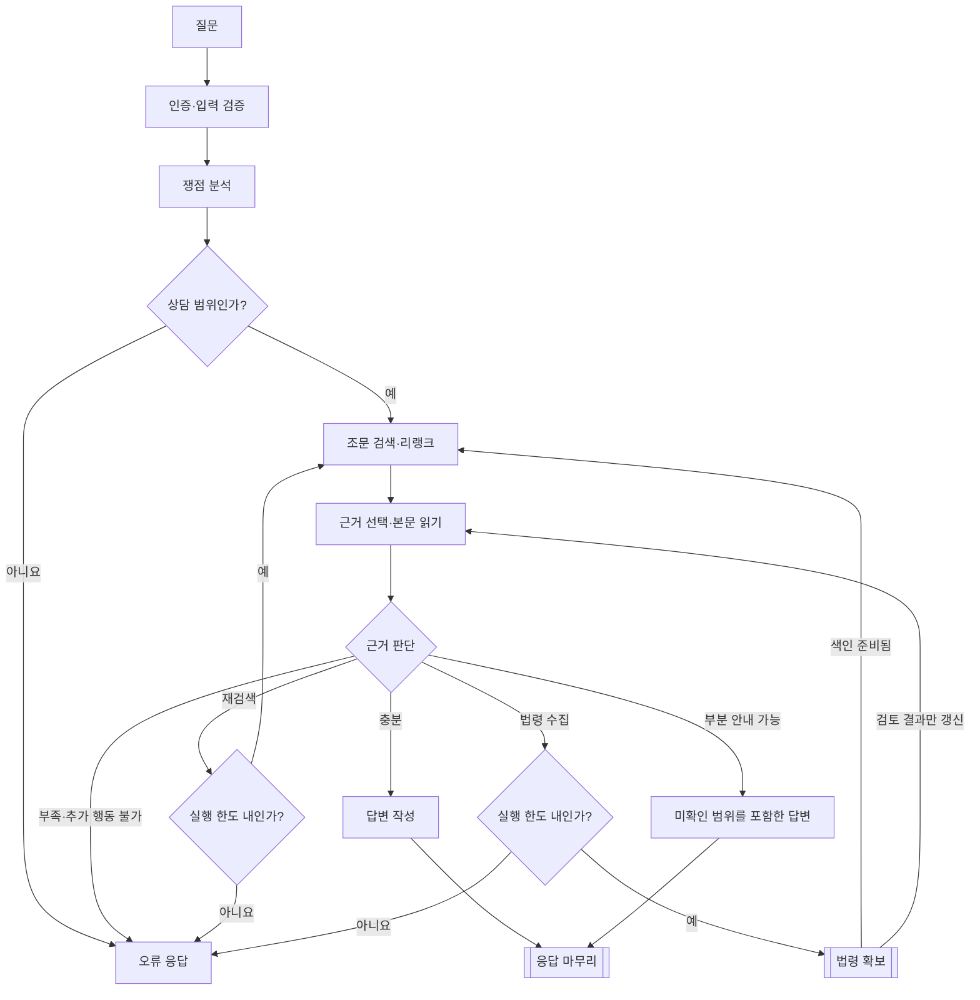
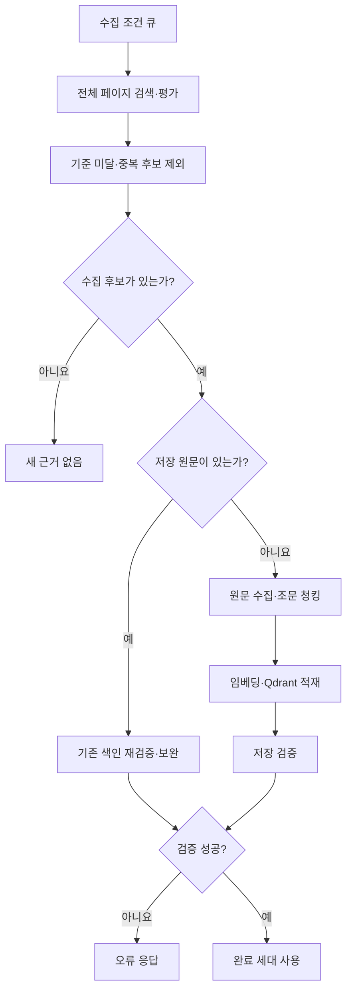
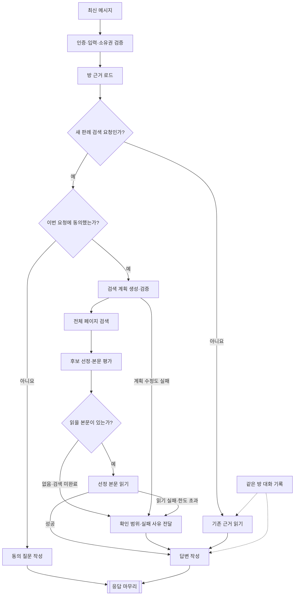
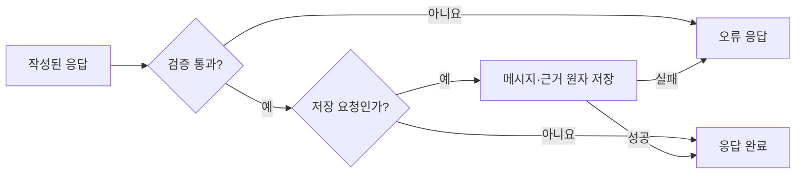

# 구현 기능과 질문 처리 흐름

기준일: 2026-10-26, 현재 `dev` 작업 코드 기준. 구현된 경로와 실제 법률 품질 검증은 구분한다.

흐름별로 나누어 읽는다: [로그인](../auth/login-flow.md) · [채팅방 생성·제목 변경](../chat/chat-room-management.md) · [첫 질문](#첫-질문) · [법령 확보](#법령-확보) · [후속 질문](#후속-질문) · [응답 마무리](#응답-마무리).

## 기능 현황

| 기능 | 구현 내용 | 상세 문서 |
| --- | --- | --- |
| 인증·사용자 | 이메일 가입·로그인, Google OAuth, 프로필·비밀번호·탈퇴, 입력 검증, CSRF, 5분 Access JWT, Redis Refresh 회전·재사용 탐지 | [인증](../auth/refresh-rotation.md), [사용자](../auth/user-account-validation.md) |
| 상담방 | 사용자별 목록·대화 조회·제목 변경·삭제, 소유권 검사, 질문·답변 암호화 저장 | [생성·관리](../chat/chat-room-management.md), [저장](../chat/chat-storage.md) |
| 질문 분석 | 목적·사실·복수 쟁점·명시 대상·후보 법령·쟁점 관계 구분, 원문 인용 검증, 쟁점별 질의 생성 | [질문 라우팅](../law/question-routing.md) |
| 법령 검색·수집 | 검색 필드·정확한 명칭·소관부처 옵션, 전체 페이지 후보 평가, 점수·선정 사유, 중복 수집 방지·진행 이력 | [법령 도구](../law/legal-api-tools.md) |
| ETL·색인 | Reader → Transformer → Writer, 조문 청킹, KURE 임베딩, Qdrant 적재·재조회 검증, 완료 세대 재사용·증분 색인 | [ETL](../law/law-etl-local.md), [증분 색인](../law/incremental-law-indexing.md) |
| 조문 RAG | 완료 세대 필터, 벡터 검색, 선택적 로컬 BGE 리랭크, 쟁점별 결과 병합·균형 배치, 최대 15개 조문 후보 | [조문 리랭크](../law/article-reranking.md) |
| 근거 판단·답변 | 후보 목록과 본문 입력 분리, 읽을 근거 선택, 충분성·추가 행동 판단, 부분 일반 안내, UUID 인용 소속 검증 | [본문 읽기](../law/evidence-reading.md), [판단 계약](../law/evidence-decision.md) |
| 후속 대화 | Advisor로 기록 복원, 고정 법령 근거 사용, 새 판례 검색 실행계획, 동의 확인 | [후속 상담](../chat/follow-up-consultation.md) |
| 판례 검색 | 특정 사건·유사 쟁점 구분, 사건명/본문/참조법령 범위 선택, 전체 페이지 수집, 후보 선정·본문 관련성 평가 | [판례 흐름](../law/case-retrieval-reranking.md) |
| 근거 관리 | 최초 스냅샷, 실제 읽고 인용한 새 판례만 누적, 근거 목록·본문 분리 조회 | [상담방 근거](../chat/room-evidence.md) |
| 진행 상태 | 최초 SSE·NDJSON, 후속 NDJSON, 실제 단계·근거·임시 답변·완료·오류 이벤트 | [스트리밍](../chat/initial-answer-stream.md) |
| 개발 환경 | local Swagger, ETL 진단, AI Search 비교 코드, DB/AI/백엔드 Compose 분리 | [Docker](../../docker/README.md), [검증](../validation/validation-status.md) |

## 첫 질문

사각형은 처리, 마름모는 판단, 이중 테두리는 다른 그림의 절차다. 별도로 그리지 않은 단계 오류도 오류 응답으로 종료한다.

기본 Qdrant 경로다. 쟁점별 검색·선택적 BGE 리랭크·결과 병합 후 최대 15개 조문을 비교한다. 재검색은 새 질의만 실행하며 중복 질의·진행 없는 수집은 반복하지 않는다. 일반 안내의 첫 부족 판단에는 한 번의 재검토가 있다. 각 단계의 형식·시간·호출 오류는 오류 응답으로 종료한다.

### 법령 확보

Reader → Transformer → Writer가 수집 원문을 처리한다. 수집 조건별 전체 페이지 평가를 마친 뒤 후보를 고르고, 각 조건의 색인 준비 후 재검색한다. 원문·후보가 없으면 다음 후보·조건을 확인한다. 완료 세대만 검색하며 실패·부분 세대는 제외한다.

## 후속 질문

- 검색은 사용자 요청을 따른다. 기존 방 법령과 일치하지 않는 과거 사건도 검색한다.
- 검색 여부는 최신 메시지만으로 판단한다. 정리·요약 요청에 과거 판례 검색을 승계하지 않으며, 기존 근거 답변 단계에는 검색·동의 요청 도구가 없다.
- 실선은 실행 순서, 점선은 답변용 맥락 제공이다. 대화 기록은 검색 여부 판단에 전달하지 않는다.
- 검색 계획은 목적·식별어·키워드·범위를 구분한다. 검증 실패 시 한 번 수정하며, 현재 요청에 없는 과거 사건을 복원하지 않는다.
- 관련성은 근거 후보의 본문을 평가할 때 검토한다. 검색 목록만으로 근거에 추가하지 않는다.
- 동의는 요청의 `allowCaseSearch=true`로 확인한다. 이전 턴의 동의를 자동 승계하지 않는다.
- 동의 질문도 저장 후 현재 요청을 종료한다. 사용자의 승인은 별도 요청으로 처리한다.
- 실패·한도 초과는 판례 부재와 구분하고, 실제로 읽지 못한 판결은 인용하지 않는다.

### 응답 마무리

- 모델 답변은 길이·인용 ID를 검증한다. 서버가 만든 동의 질문도 길이 검사를 거쳐 질문·답변으로 저장한다.
- 최초 상담은 방·암호화 메시지·최초 근거를 저장한다. 후속 상담은 메시지와 실제 인용한 새 판례만 추가한다. 무저장 답변은 저장을 생략한다.
- 스트리밍의 답변 조각은 검증 전 임시 내용이다. `completed`만 최종 결과이며 `error`가 오면 임시 답변을 폐기한다. 저장 후 연결 해제는 이미 커밋된 저장을 되돌리지 않는다.

## LLM과 서버의 역할

| LLM이 판단 | 서버가 실행·검증 |
| --- | --- |
| 질문 목적·쟁점·키워드 | 인증·소유권·동의 |
| 근거 읽기 선택·충분성·추가 행동 | API 호출·원문 복원·ETL·실행 한도 |
| 판례 목적·검색 범위·관련성 | 후보 ID·원문 출처·색인 세대 검증 |
| 최종 설명 | UUID 인용 소속·저장·암호화·이벤트 전달 |

역할별 Builder/ChatClient와 Advisor를 사용하는 서버 주도 오케스트레이션이다. 독립 에이전트가 자유롭게 도구를 실행하는 범용 멀티 에이전트 플랫폼은 아니다. 인용 검증은 출처 소속을 확인하며 법적 주장과 근거의 의미적 일치까지 보장하지 않는다.

## 남은 작업

1. 실제 사건별 검색 재현성·직접 판결 여부·복수 쟁점 누락·최종 인용 품질 평가.
2. 검색 계획·근거 읽기·최종 인용 실패의 원인 관측과 복구 보강.
3. 후속 대화의 새 법령 자동 수집·기준일과 개정 이력 처리 보강.
4. 사용자에게 추가 사실을 묻고 이어받는 전용 질문 구체화 흐름.
5. 실제 usage 비용 정산 알고리즘, 영속 작업·중단 재개·멱등성·분산 동시성 제어.
6. AI Search 실 API 장애 확인·공급자 비교, SerpApi 도입 검토, 운영 보안·복구·배포 검증.

독립적인 최종 답변 완결성 검사 LLM은 보류 상태다. 최근 실제 모델 테스트는 성수대교 검색 목적 보존과 목록 후보 선택을 확인했으며, 실제 판결 확보부터 최종 답변까지의 품질 합격을 의미하지 않는다. 세부 작업은 [작업 계획](../plans/README.md)을 따른다.
