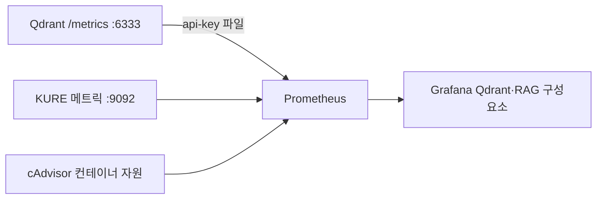

# Qdrant·RAG 구성요소 모니터링

2026-10-29 검토·연결 완료. Grafana의 **MoleLaw 부하 테스트 - Qdrant·RAG 구성요소**
(`molelaw-loadtest-rag`)에서 한국어 패널 19개를 확인한다.



## 검토 결과와 범위

| 구간 | 현재 관측 | 한계 |
| --- | --- | --- |
| Qdrant | 연결·컬렉션/벡터 수·REST 처리량/p95·메모리 | 단일 노드. 컬렉션 목록·정보·스냅샷 API는 Qdrant REST 지표에서 제외 |
| 임베딩 | HTTP 상태별 처리량·전체 요청 지연·공유 게이트 대기·인코더 시간·처리 텍스트 수 | 실제 모델 요청이 있어야 추론 지연 표본 생성 |
| 리랭킹 | 위 지표를 rerank로 분리, 처리 후보 수·predict 시간 | 임베딩과 잠금·대기열을 공유하므로 서로 영향을 줄 수 있음 |
| 준비/용량 | 모델 로드 여부·사용 중/대기 요청·큐 포화/대기 만료·배치/큐 설정 | scrape UP은 모델 준비 완료와 다름 |
| 자원 | Qdrant·KURE 컨테이너 CPU 코어·working set | 모델 파일 매핑·페이지 캐시와 메모리 지표의 의미를 구분 |
| 전체 RAG | 기존 백엔드 HTTP/JVM/Hikari 지표 | 질문 분석·검색 조립·원문 조회·전체 파이프라인의 구간별 전용 계측은 아직 없음 |
| AI 답변 | 이번 범위에서 보류 | 생성 모델 호출·첫 토큰/완료·비용은 측정하지 않음 |

현재 최소 백엔드는 `LT_RAG_ENABLED=false`를 유지한다. Qdrant/KURE 구성요소를 실제로 실행해
계측을 확인했지만, 이를 백엔드 전체 RAG 흐름을 검증한 결과로 표시하지 않는다.
다음 임베딩 성능 시험은 짧은/긴 입력·배치·동시성에 따라 진행하고 생성 답변 시험은 그 결과로 판단한다.

## 실행

테스트 전용 `.env`와 기존 최소 모니터링 환경이 준비된 상태에서 실행한다.

```powershell
.\scripts\load-testing\prepare-rag-monitoring.ps1
docker compose --env-file docker/loadtest/.env -f docker/loadtest/compose.yml --profile rag build kure
docker compose --env-file docker/loadtest/.env -f docker/loadtest/compose.yml --profile rag up -d qdrant kure prometheus grafana
.\scripts\load-testing\check-rag-monitoring.ps1
```

Prometheus 인증 헤더는 `build/loadtest-secrets/qdrant-api-key`를 읽는다. 스크립트는 Git 제외
`docker/loadtest/.env`의 테스트 키로 이 파일을 준비하며 값을 출력하지 않는다.
Prometheus 컨테이너에 읽기 전용 디렉터리로 마운트하고 YAML·Git·대시보드에는 키를 넣지 않는다.
인증 정책을 완화하지 않았으며 비인증 `/metrics` 호출의 401/403을 검사한다.

KURE의 메트릭 포트 9092는 Docker 내부에만 두고 호스트에 공개하지 않는다.
`METRICS_PORT`를 설정했을 때만 관리 서버를 열며 기본 단독 실행은 0(비활성)이다.
모델 로드 전에 메트릭 서버를 시작하므로 다운로드·로딩 중에도 `model_ready=0`을 볼 수 있다.
사용자용 기존 `/api/version`, `/api/embed`, `/api/rerank` 계약과 추론 잠금·큐 상한은 유지했다.

이번 환경은 공개 모델 캐시를 기존 lab 볼륨에서 **읽기 전용으로** 읽어 테스트 전용
`molelaw-loadtest_model_cache`에 복사했다. 원본 캐시를 수정하거나 인증 파일을 복사하지 않았다.
HF 캐시가 공통 `hub/blobs`를 가리키는 심볼릭 링크를 쓰므로 모델 디렉터리만 복사하면 안 된다.
캐시가 없으면 모델 서버의 다운로드 네트워크에서 공개된 고정 revision 가중치를 받는다.
이 네트워크는 모델 서버만 사용하며 백엔드에 유료 API 접근을 추가하지 않는다.

## 메트릭 해석

- `kure_request_duration_seconds`: 본문 읽기·검증·대기·모델 준비·추론·응답 전송을 포함한 POST handler 시간.
- `kure_queue_wait_seconds`: 공유 추론 잠금을 얻기까지의 시간. 대기 만료 시도도 포함한다.
- `kure_inference_duration_seconds`: embed의 encode, rerank의 predict 실행. 실패 시도도 기록하며 모델 로딩·입력 검증과 구분한다.
- `kure_inference_active`: 잠금을 보유한 요청 수. 검증·모델 준비·unload 구간도 포함하므로 순수 CPU 실행 수가 아니다.
- `kure_processed_items_total`: 인코딩을 완료한 텍스트 수/점수 계산을 완료한 후보 수. HTTP 요청 수와 다르다.
- `kure_rejections_total`: full(입장 거부), timeout(잠금 대기 만료). GPU OOM 등 다른 503은 HTTP 상태 지표에서 확인한다.
- 상태 카운터는 서버가 만든 응답 기준이며 클라이언트가 응답을 끝까지 수신했다는 보장은 아니다.

operation은 embed/rerank/other, 상태·거부 이유는 정해진 값만 사용한다. 질문·문서 원문·사용자/문서 ID·토큰을
메트릭 레이블로 사용하지 않는다. health/메트릭 조회는 추론 처리량에 포함하지 않는다.
1분 rate 기반 지연 패널은 요청이 없으면 빈 값/NaN이 될 수 있다. 이를 0ms로 바꾸지 않는다.
연결 상태와 모델 준비를 먼저 확인하고 실제 요청이 있었던 시간 범위에서 지연을 읽는다.

## 검증

- Qdrant 1.19.1 인증 `/metrics` 수집과 비인증 차단 확인. 기존 컬렉션을 덮어쓰지 않는 임시 4차원 컬렉션에
  벡터 1개를 넣어 검색 성공을 확인한 뒤 삭제했다. REST 요청·지연 히스토그램의 생성을 확인했다.
- 고정 KURE-v1 실제 짧은 입력 1개는 1,024차원·unit norm, 로컬 리랭커는 후보 2개·유한 점수를 반환했다.
  이는 연동 smoke이며 처리량·검색 품질·성능 한계의 검증 결과가 아니다.
- 모델 다운로드 없이 실행하는 Python 회귀 9개 통과. 추론 중 메트릭 응답, 입력 원문 미노출,
  포화 거부 카운터와 gate 해제 후 active/waiting=0을 추가 검증했다.
- Prometheus 타깃 9개 모두 UP, KURE 두 모델 준비=1, Grafana 등록 19패널과 18개 PromQL의 실행·시리즈 존재 확인.
- Spring Java/API 변경은 없으므로 기존 JUnit 전체 실행을 새 결과로 표시하지 않는다.

근거: [Qdrant 모니터링](https://qdrant.tech/documentation/ops-monitoring/monitoring/),
[Prometheus HTTP 헤더 파일 설정](https://prometheus.io/docs/prometheus/latest/configuration/configuration/),
[Prometheus Python client](https://prometheus.github.io/client_python/).
