# 1차 테스트 결과 시각화

**1차 테스트**는 2026-10-28~29의 조회·DB·Refresh·임베딩·리랭커·혼합 부하·AI 생성 및 고정 색인 RAG 시험 묶음이다. [결과 요약과 개선 연결](first-round.md)을 기준으로 후속 리팩토링 전 기준선으로 보존한다. 문서의 확정 표에서 값을 추출했으며 시각화 작성일은 2026-10-30이다. **새 부하·유료 호출을 실행하지 않았다.** 장비·입력·측정 창·발생기 조건이 다른 시험의 수치를 하나의 성능 순위로 합치지 않는다.

SVG는 저장·확대 가능한 파일이며 [그래프 데이터](figures/data.json)도 함께 보존한다. 원시 요청 로그가 아닌 기존 보고서의 집계값을 사용했다. 약식 RPS·작은 표본·실패·미실행 범위는 각 그림과 원본 문서에 표시했다. 재생성 방법은 [agent.md](../agent.md#시각화-갱신)를 따른다.

## 조회 API

512 VU의 약 180초 확인은 약 146 RPS·p95 17ms·오류 0이었다. 1,024 VU 지속 시험은 HTTP 500으로 중단했고, 2,048 VU에서는 처리량 증가보다 지연 증가가 두드러졌다. VU에는 요청 사이 2~5초 쉬는 시간이 포함된다.

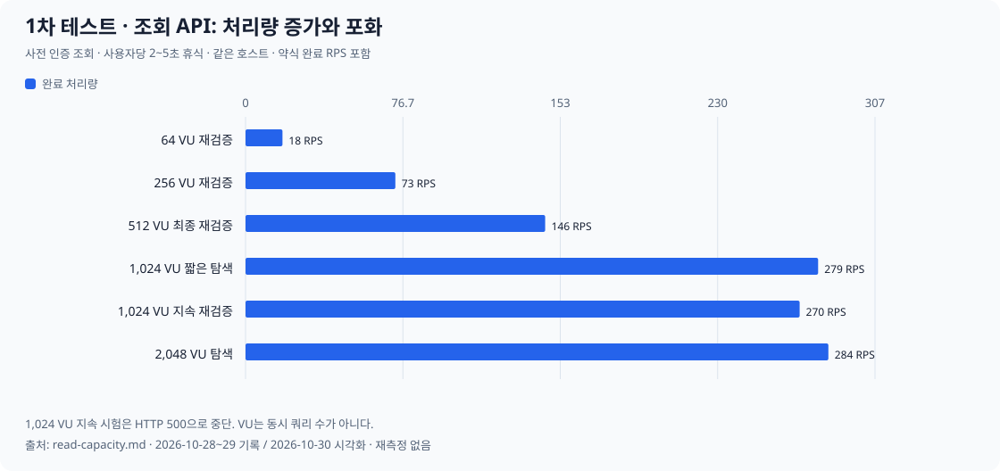

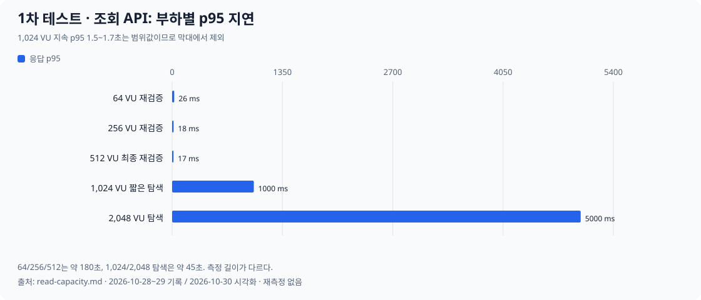

1,024 VU 지속 시험의 p95는 1.5~1.7초 범위로 기록되어 있어 지연 그래프의 단일 막대로 바꾸지 않았다. [환경·실행 ID·원본 결과](read-capacity.md).

## MySQL 직접 부하

읽기는 CPU 1개 조건에서 연결 수 증가가 처리량 개선으로 이어지지 않았다. 혼합은 탐색 32연결까지 처리량이 증가했다. 읽기·혼합은 SQL 구성이 다르며 TPS를 API RPS로 환산하지 않는다.

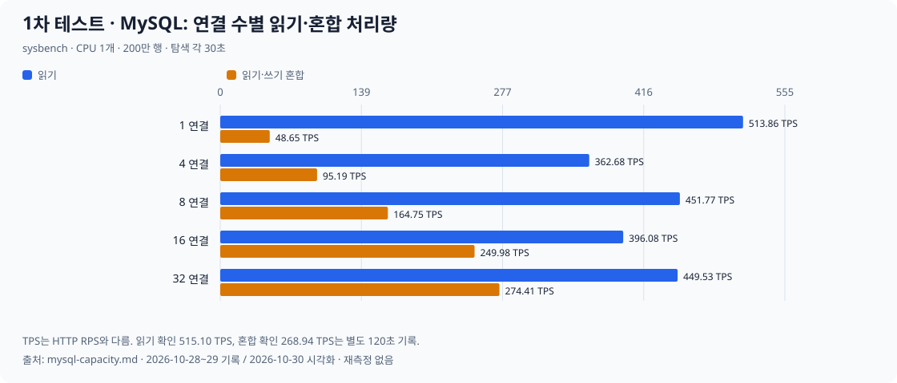

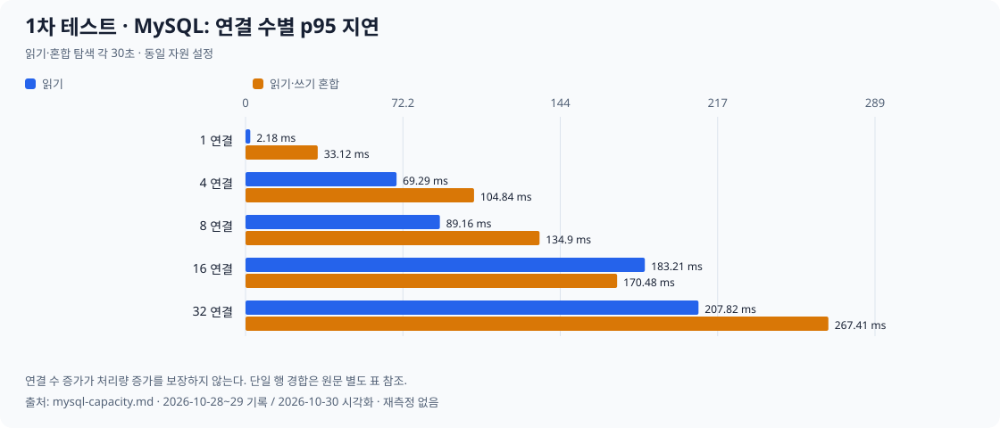

위 그림은 30초 탐색이다. 별도 120초 확인은 읽기 1연결 515.10 TPS·p95 2.18ms, 혼합 32연결 268.94 TPS·p95 257.95ms였다. [전체 표·락 경합 결과](mysql-capacity.md).

## Redis와 Refresh API

Redis 직접 명령 OPS와 실제 Refresh HTTP RPS를 별도 그림으로 표시했다. Redis 직접 부하는 연결 50개·pipeline 1의 지속 측정만 선택했다. 값 크기와 명령이 달라 비용이 같다는 의미는 아니다.

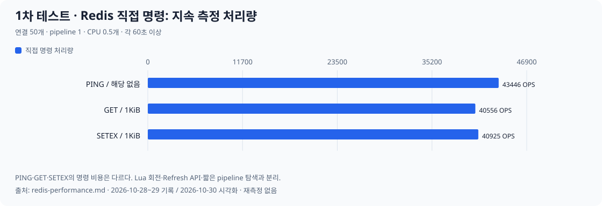

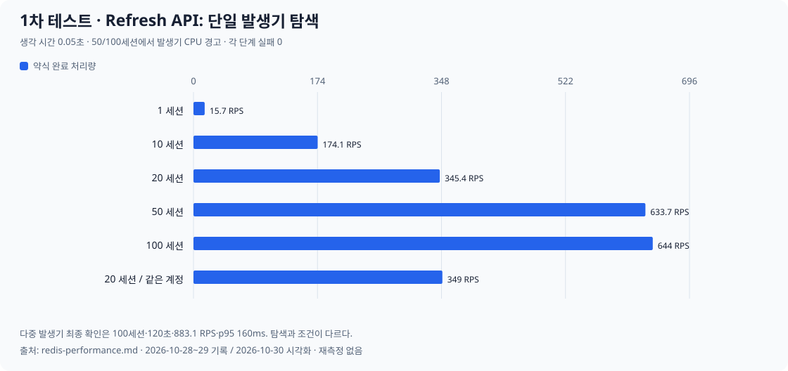

Refresh 그림의 50/100세션은 단일 발생기 CPU 경고가 있었다. 이후 프록시 제한을 보정한 4프로세스·100세션·120초 확인은 **105,980회·약 883.1 RPS·p95 160ms·실패 0**이었다. 서로 다른 조건이므로 한 추세선으로 연결하지 않았다. [원본 결과와 장애 복구](redis-performance.md).

| 장애 시험 | 관측 결과 | 복구·주의점 |
| --- | --- | --- |
| Redis OOM·연결 단절 | 503 | OOM family 유지·TTL 이후 회복, 연결 복구 후 갱신 성공 |
| Redis 지연 | timeout 후 503 | 늦은 회전 실행. 이전 토큰 재시도는 401 재사용 탐지 |
| 회전 뒤 HTTP 응답 유실 | ReadTimeout | 이전 토큰 재시도 시 family 폐기 |
| DB 연결 단절 | 500 | 회전 전 조회 실패·family 유지·연결 복구 후 성공 |

## 임베딩과 리랭커

임베딩은 짧은 질문과 511~512토큰 문서를 나눴다. 성공 처리량과 503 거부율을 함께 읽어야 한다. 같은 서버의 실제 동시 추론은 1개다.

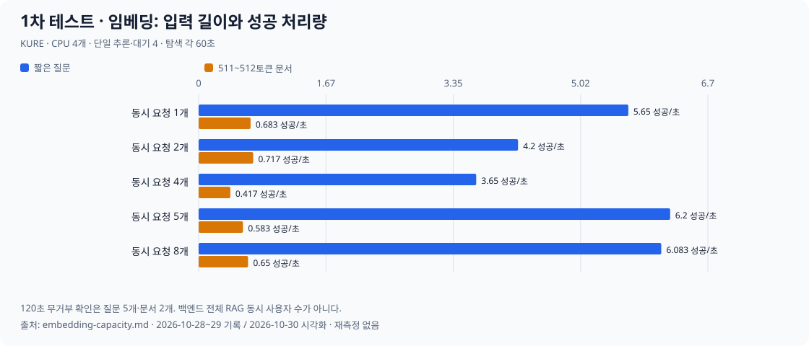

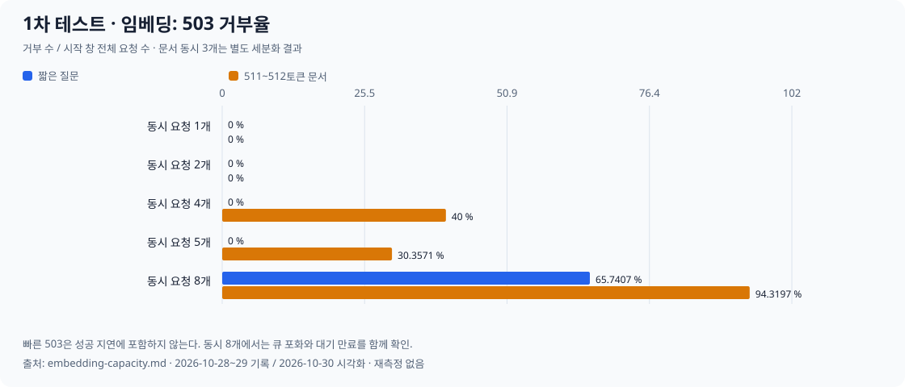

120초 무거부 확인은 질문 동시 5개·문서 동시 2개였다. 문서 동시 3개 세분화에서는 38시도 중 3건 거부를 관측했다. [조건·전체 표](embedding-capacity.md).

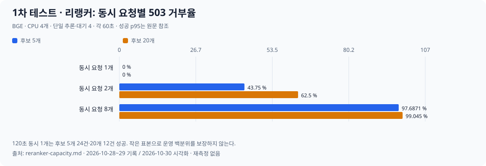

리랭커는 동시 2개부터 대기 만료가 발생했다. 별도 동시 1개·120초 확인은 후보 5개 0.192 성공/초·p95 10.394초, 후보 20개 0.092 성공/초·p95 14.535초였다. [성공 수·회복·작은 표본 제한](reranker-capacity.md).

## 임베딩·리랭커 혼합

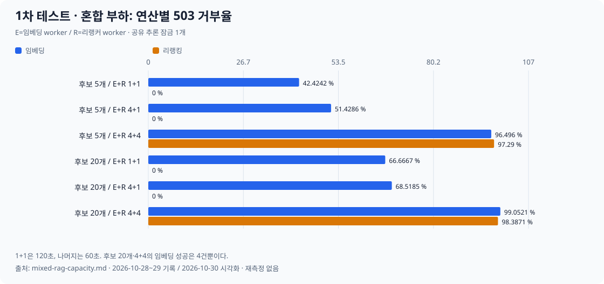

worker 1+1에서도 긴 리랭킹 뒤 임베딩 대기 만료를 관측했다. 후보 20개·4+4에서 임베딩 성공 p95가 0.711초로 낮아졌지만 성공은 4건뿐이고 거부율은 약 99.1%였다. 이 결과를 지연 개선으로 읽을 수 없다. [입력 분포·공유 잠금·회복 결과](mixed-rag-capacity.md).

## 최종 AI 생성과 전체 RAG

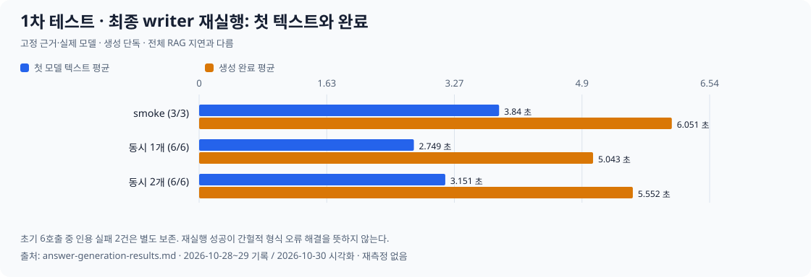

writer 재실행은 진단 1건과 정규 15건이 성공했다. **앞선 6호출의 인용 실패 2건을 포함한 기록은 유지한다.** 위 막대는 성공 재실행의 평균이며 안정적인 p95·운영 수용량을 의미하지 않는다. [초기 실패·재실행·비용](answer-generation-results.md).

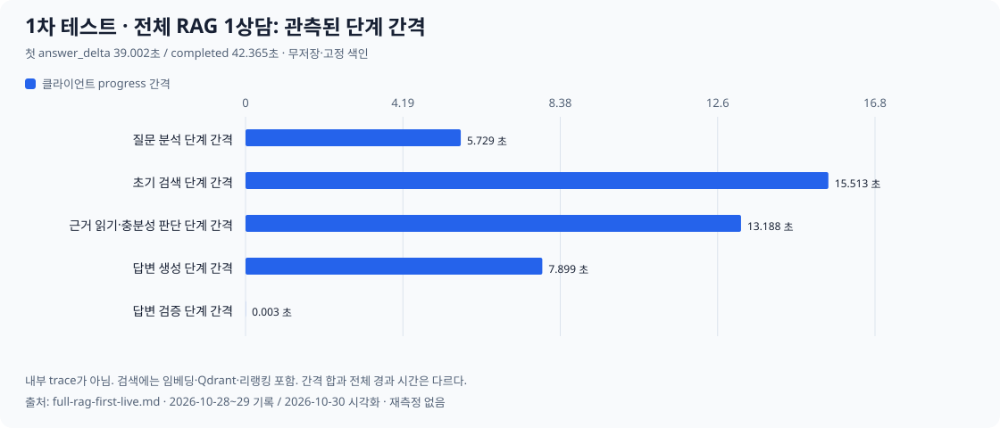

무저장·고정 색인의 실제 RAG 1상담은 첫 answer_delta 39.002초, completed 42.365초였다. 단계별 막대는 클라이언트 progress 사이 간격이다. 내부 span이나 전체 경과 시간의 정확한 분해가 아니므로 합계를 전체 시간으로 맞추지 않았다.

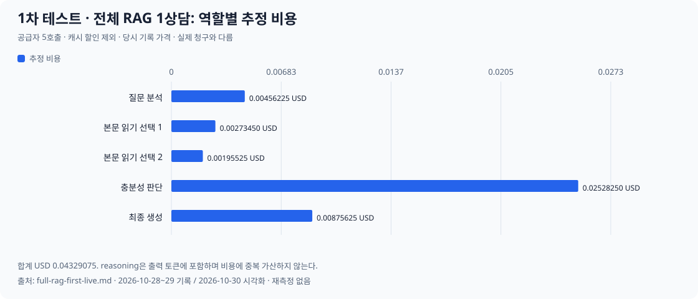

공급자 5호출의 캐시 할인 제외 추정 비용은 USD 0.04329075였다. 당시 기록 가격 기준이며 실제 청구 금액과 다르다. [실효 effort·usage·원본 기록](full-rag-first-live.md).

| 검증 단계 | 확인된 범위 | 남은 범위 |
| --- | --- | --- |
| 스트림 HTTP 대역 A | 14건, 실패/건너뜀 0. 조기 delta·terminal·저장·장애·취소·슬롯 회복 | 실제 공급자 과금 중단·브라우저 연결 해제 전체 |
| 실제 최종 생성 B | 초기 실패 기록, 재실행 진단 1+정규 15건 성공 | 간헐적 인용 형식 오류 해소·사건별 법률 품질 |
| 고정 색인 전체 RAG C | 합성 준비 검증·실제 무저장 1상담 완료 | 전체 RAG 동시 부하·동적 수집·장시간 안정성 |
| 실제 저장형 D | 미실행 | 저장형 전체 흐름과 동시성 |

단계별 결과는 [시험 계획](answer-generation-plan.md)과 [검증 현황](../validation/validation-status.md)을 함께 읽는다. 테스트 통과 건수는 성능이나 법률 정확도 합격률로 환산하지 않는다.
