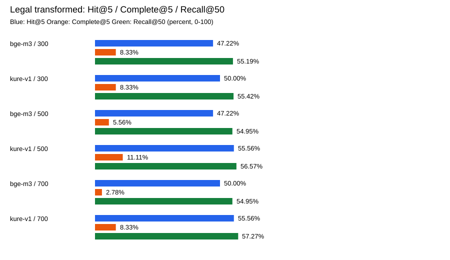

# Recall@50 모델 비교

법률 쟁점 변환 질의, 같은 36문항·정답·코퍼스를 비교한다. Hit@5와 Complete@5가 공동 우선이다. 점수 임계값을 적용하지 않았다.

| 모델 | 문자 | Hit@5 | Complete@5 | Recall@5 | Recall@50 | Hit@50 | Complete@50 |
| --- | ---: | ---: | ---: | ---: | ---: | ---: | ---: |
| bge-m3 | 300 | 17/36 | 3/36 | 27.55% | 55.19% | 28/36 | 12/36 |
| kure-v1 | 300 | 18/36 | 3/36 | 28.70% | 55.42% | 29/36 | 12/36 |
| bge-m3 | 500 | 17/36 | 2/36 | 27.08% | 54.95% | 28/36 | 11/36 |
| kure-v1 | 500 | 20/36 | 4/36 | 31.39% | 56.57% | 30/36 | 11/36 |
| bge-m3 | 700 | 18/36 | 1/36 | 25.23% | 54.95% | 28/36 | 11/36 |
| kure-v1 | 700 | 20/36 | 3/36 | 30.56% | 57.27% | 30/36 | 11/36 |

Hit@5는 필요한 근거를 하나 이상 찾은 문항 수, Complete@5는 필요한 근거 전부를 찾은 문항 수다. Recall@50은 정답 근거 중 상위 50개에 포함된 비율을 문항별로 평균한 값이다. 50개 후보를 확보해도 최종 상위 5개의 품질이 자동으로 높아지지는 않는다.

[세 질의 버전 전체 CSV](model-comparison.csv) · [실험 조건과 상태](../README.md)

## 완료 검증

- kure-v1 : completed; 324 queries / 16200 ranks; ranking metrics independently recalculated
- bge-m3 : completed; 324 queries / 16200 ranks; ranking metrics independently recalculated
- qwen3-0.6b : final report absent; excluded from comparison

최종 report.json이 없는 모델은 미완료로 표시하고 비교에 넣지 않는다. 이미 탐색한 작은 튜닝 표본이며 고정 정답 외 대체 근거 누락 가능성이 있다. 모델의 일반적 우열이나 서비스 준비 완료를 뜻하지 않는다.
