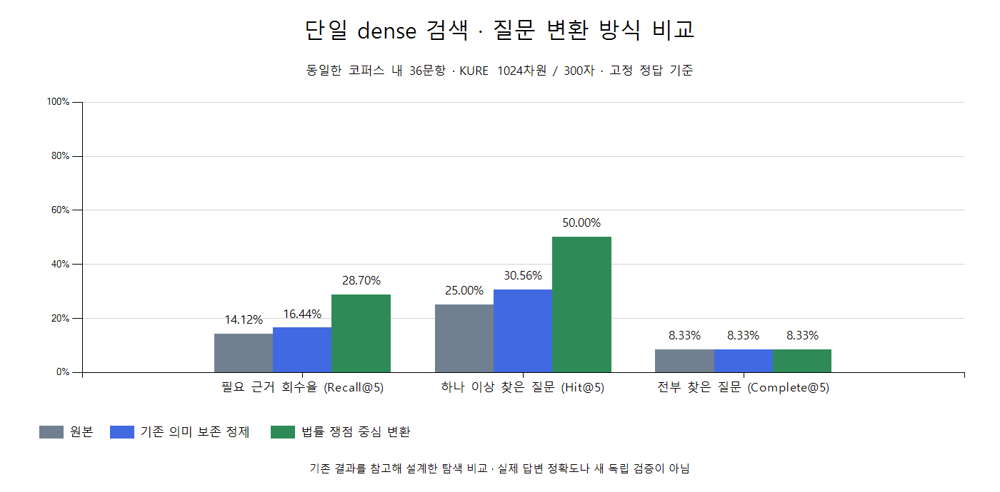

# 법률 쟁점 중심 질의 변환 결과 해석

2026-10-20 완료. 원본 질문만 읽는 변환 담당과 별도 의미 검수 담당을 분리하고 100개 변환문을 검색 전에 고정했다. 사실·결론 단정 위험 4건은 실행 전에 수정했다. 동일한 원본 100문항·정답·KURE·문서 10,999개를 유지했고, 기존 원본·의미 보존 정제 200개 결과에 새 변환 100개를 추가해 비교했다.

## 코퍼스 내 36문항 비교

| 지표 | 원본 | 기존 의미 보존 정제 | 법률 쟁점 중심 변환 |
| --- | ---: | ---: | ---: |
| Recall@5 | 14.12% | 16.44% | 28.70% |
| Recall@10 | 21.53% | 23.84% | 38.29% |
| Hit@5: 정답 하나 이상 확보 | 9/36 (25.00%) | 11/36 (30.56%) | 18/36 (50.00%) |
| Complete@5: 필요한 정답 모두 확보 | 3/36 (8.33%) | 3/36 (8.33%) | 3/36 (8.33%) |
| 검색 1위가 고정 정답인 질문 | 4/36 | 2/36 | 9/36 |
| MRR@10 | 0.1755 | 0.1463 | 0.3540 |

법률 쟁점 중심 변환은 기존 정제보다 Recall@5가 12.27%p 높고, 하나 이상의 정답을 확보한 질문이 7개 많다. 첫 정답 순위 지표도 좋아졌다. 같은 36문항에서 Recall@5가 개선된 질문은 9개, 악화된 질문은 1개, 같은 질문은 26개다. 문항별 차이는 [대응 비교 CSV](paired-recall-changes.csv)에 남겼다.

단순 문장 다듬기보다 검색용 법률 개념을 드러내는 방식의 효과를 이번 표본에서 확인했다. 하지만 필요한 근거를 모두 확보한 질문 수는 3개로 늘지 않았다. 높은 답변 정확도나 근거 충분성이 입증된 것은 아니다. 실제 서비스 LLM 프롬프트의 일관된 변환 품질·지연·비용을 측정한 것도 아니다.

## 개선과 악화 예시

`ind-051`은 결혼식장 취소 시 큰 위약금을 요구받았다는 질문이다. 새 질의는 서명한 위약금 조항의 효력과 과도한 손해배상 예정액의 감액 가능성이라는 검색 개념을 표현했다. 변환 후 민법 제398조가 1위, 약관의 규제에 관한 법률 제8조가 3위로 검색돼 고정 정답 3개 중 2개를 상위 5개에서 찾았다. 기존 정제의 Recall@5 0에서 66.67%가 됐다.

반면 `ind-027` 손님 얼굴이 보이는 CCTV의 홍보용 게시 질문은 기존 정제의 고정 정답 Recall@5 33.33%에서 새 변환 0으로 낮아졌다. 모든 질문에서 법률 개념 보강이 유리하지는 않다. 고정 정답 외 관련 조문이 있을 수 있으므로 0점을 모든 검색 결과가 무관하다는 뜻으로 해석하지 않는다.

## 임계값과 범위 판단

| 분류 | 문항 | 기존 정제의 점수 수용 | 법률 쟁점 중심 변환의 점수 수용 |
| --- | ---: | ---: | ---: |
| 코퍼스 내 | 36 | 10/36 (27.78%) | 23/36 (63.89%) |
| 추가 자료 필요 | 44 | 3/44 (6.82%) | 11/44 (25.00%) |
| 해외 관할·개인 사건 조회 | 15 | 2/15 (13.33%) | 2/15 (13.33%) |
| 핵심 사실 부족 | 5 | 3/5 (60.00%) | 1/5 (20.00%) |

두 변환 모드에 같은 기존 정제 임계값 0.59829341466087427을 진단용으로 적용했다. 새 변환은 코퍼스 내 질문의 점수뿐 아니라 추가 자료가 필요한 질문의 점수도 높였다. 검색에 적합한 표현과 자료가 충분하다는 판단은 별개다. 이 수용률을 LLM의 범위 판단 정확도나 생성 답변 오류율로 해석하지 않는다.

이전 임계값 탐색은 기존 정제 점수에 대한 결과다. 새 변환 입력을 사용할 때는 그 점수 분포로 별도 조정·검증해야 하며 이전 후보값을 그대로 최적값으로 간주하지 않는다. 이번 비교에서는 새 모드의 임계값을 최적화하거나 서비스 설정을 변경하지 않았다.

## 검증 범위와 보존

기존 결과를 알고 전략을 설계한 탐색·튜닝 평가다. 변환 작성·검수 담당이 정답이나 검색 결과를 읽지 않았어도 이 질문셋 전체를 새 독립 held-out이라고 부르지 않는다. 같은 계열 LLM 역할 분리의 한계, 고정 정답의 대체 근거 누락 가능성, 코퍼스 내 36문항의 작은 표본도 유지된다. sparse 검색은 실행하지 않았으며 sparse와 동등하거나 대체 가능하다는 비교 증거는 없다.

입력·manifest 해시, 결과 300행·순위 3,000행, 양성 108회(36×3모드)의 순위 지표 재계산을 확인했다. 별도 에이전트가 기존 200개 질문·2,000개 순위 행의 보존과 신규 Qdrant 100개 포인트의 payload·벡터를 대조했다. 신규 3개 질문 표본의 캐시 벡터와 Qdrant 전수 재검색도 일치했다. [실행 검토 근거](execution-check.json)를 보존한다.

KURE와 문서 색인은 유지했고 모델 컨테이너는 실행 후 중지했다. 이번 결과는 질의 변환의 검색 효과를 지지하는 탐색 근거로 남기며 `serviceReady=false`를 유지한다. 충분성 판단·추가 수집·답변 생성·다른 임베딩 모델 비교는 이번 실험에서 실행하지 않았다.

[집계 보고서](README.md) · [상위 10개 조문과 유사도](top10.csv) · [고정 입력](../../data/manifest.json) · [작성·검수 계획](../../review/README.md)
