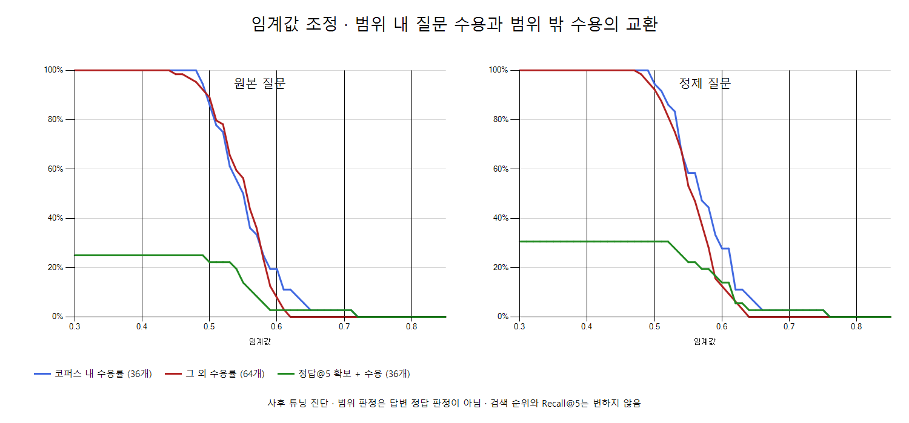

# KURE 임계값 탐색 이력 — 초기화 완료·현재 미사용

현재 상태: 탐색 후보는 초기화(비활성)했다. 서비스와 고정 평가 기준값은 변경한 적이 없다. 현재 Recall@50은 임계값 필터 없이 계산한다. 아래 표·그래프·CSV는 과거 분석 이력이며 적용 중인 설정이나 추천값이 아니다. [상태 기록](reset-status.json)은 문서용 기록이며 런타임 설정 파일이 아니다.

새 추론 없이 독립 질문 100개 × 원본/정제의 저장된 최고 유사도를 재사용했다. 기준값 이상이면 질문을 수용하는 방식이다. 임계값을 낮추면 많은 질문을 받아들이지만 필요한 정답을 새로 찾지는 않는다. 검색 순위와 기존 Recall@5는 변하지 않는다.

| 방식 | 후보 목적 | 임계값 | 코퍼스 내 수용 | 그 외 수용 | 수용 중 1위가 고정 정답인 비율 | 정답@5 확보+수용 |
| --- | --- | ---: | ---: | ---: | ---: | ---: |
| original | 기존 | 0.59257075 | 7/36 | 8/64 | 6.67% | 1/36 |
| original | 범위 구분 균형(사후) | 0.60092247 | 7/36 | 5/64 | 8.33% | 1/36 |
| original | 범위 내 70% 이상 수용 | 0.52191055 | 26/36 | 49/64 | 4.00% | 8/36 |
| original | 그 외 수용 10% 이하 | 0.60092247 | 7/36 | 5/64 | 8.33% | 1/36 |
| rewritten | 기존 | 0.59829341 | 10/36 | 8/64 | 5.56% | 5/36 |
| rewritten | 범위 구분 균형(사후) | 0.58558680 | 16/36 | 13/64 | 6.90% | 7/36 |
| rewritten | 범위 내 70% 이상 수용 | 0.53493565 | 26/36 | 43/64 | 2.90% | 9/36 |
| rewritten | 그 외 수용 10% 이하 | 0.61021640 | 10/36 | 6/64 | 6.25% | 5/36 |

existing은 원래 기준값, scope_balanced_diagnostic은 현재 표본에서 범위 구분 balanced accuracy가 가장 높은 지점, coverage_at_least_70pct는 코퍼스 내 70% 이상 수용 조건에서 그 외 수용을 줄인 지점, other_acceptance_at_most_10pct는 그 외 수용 10% 이하 조건에서 코퍼스 내 수용을 높인 지점이다. 추천 확정값이 아닌 상충관계를 보는 사후 후보이며 운영에는 적용하지 않았다.

코퍼스 내 36개를 양성, 추가 자료 필요 44개·지원 범위 밖 15개·사실 부족 5개를 나머지 64개로 묶은 것은 범위 구분의 대리 지표다. 실제 답변 정답/오답 라벨이 아니며 사실 부족 질문도 일반 법적 설명은 가능할 수 있다. 1위가 고정 정답인 비율 역시 정답 집합 외 대체 근거 누락의 영향을 받는다.

이 질문셋을 보고 임계값을 선택하므로 앞으로 이 자료는 튜닝용으로 취급한다. 기존 독립 실행과 고정 입력은 그대로 보존하되, 여기서 고른 기준값의 독립 검증 성능이라고 주장하지 않는다. 별도 새 질문으로 확인하기 전까지 서비스 준비 상태는 false다.

[원래 독립 검증](../../../retrieval-validation/independent-v1/reports/kure-v1/interpretation.md) · [모든 임계값 CSV](sweep.csv) · [후보 CSV](candidates.csv)

과거 분석 당시 표본의 정제 질문에서는 기존 약 0.598에서 코퍼스 내 10개·그 외 8개를 수용한다. 약 0.586으로 낮추면 각각 16개·13개, 약 0.535에서는 각각 26개·43개다. 범위 내 수용을 늘리면 그 외 수용도 크게 증가한다. 이 표본만으로 하나의 서비스 임계값을 확정하지 않는다. 그래프의 초록선은 상위 5개에 고정 정답이 있으면서 수용되는 질문의 비율이며, 실제 답변 정확도가 아니다.
