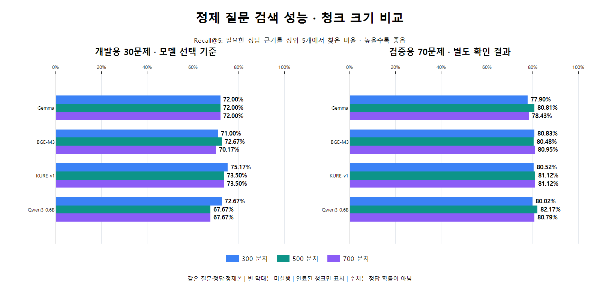

# 한눈에 보는 모델·청크 비교

기존 비교에서 선정한 검색 기준 구성은 KURE-v1 300자·중복 64자·질문 정제다. 이후 [독립 질문 검증](../independent-validation-v1/kure-v1/interpretation.md)의 낮은 고정 정답 기준 성능으로 서비스 적용은 확정하지 않는다. 아래는 동일한 기존 110문항으로 비교한 12개 구성이며, 선정 후 270문항으로 확대한 결과는 섞지 않았다. [최종 요약과 확대 검증](../final-summary.md)을 함께 참고한다.

모델별로 묶고 청크를 300 → 500 → 700문자 순서로 고정했다. 색깔은 두 그래프에서 같다. 비율 축은 모두 0~100%로 통일했고, 작은 차이는 막대 옆 숫자로 확인할 수 있다. 네 모델의 세 청크 평가 결과를 모두 표시했다.

왼쪽은 설정 선택에 사용한 개발용 질문, 오른쪽은 따로 남겨 둔 검증용 질문이다. 같은 질문에 필요한 정답 근거를 얼마나 찾았는지를 측정한 값이며 실제 답변 정답률은 아니다.

## 개발용 Recall@5가 높은 순서

같은 Recall 값은 공동 수준으로 읽는다. 동률 안에서는 모델명·청크 크기 순서로 표시했으며 검증용 점수로 순서를 바꾸지 않았다.

| 모델 | 문자 | 개발용 Recall@5 | 검증용 Recall@5 | 검증용 MRR |
| --- | ---: | ---: | ---: | ---: |
| KURE-v1 | 300 | 75.17% | 80.52% | 0.7346 |
| KURE-v1 | 500 | 73.50% | 81.12% | 0.7655 |
| KURE-v1 | 700 | 73.50% | 81.12% | 0.7699 |
| BGE-M3 | 500 | 72.67% | 80.48% | 0.7949 |
| Qwen3 0.6B | 300 | 72.67% | 80.02% | 0.7597 |
| Gemma | 300 | 72.00% | 77.90% | 0.7820 |
| Gemma | 500 | 72.00% | 80.81% | 0.8136 |
| Gemma | 700 | 72.00% | 78.43% | 0.7744 |
| BGE-M3 | 300 | 71.00% | 80.83% | 0.7577 |
| BGE-M3 | 700 | 70.17% | 80.95% | 0.8036 |
| Qwen3 0.6B | 500 | 67.67% | 82.17% | 0.7872 |
| Qwen3 0.6B | 700 | 67.67% | 80.79% | 0.7771 |

표에 포함된 구성에서 개발용 점수가 가장 높은 구성은 KURE-v1 300문자 입니다. 첫 정답 순위나 필요한 근거 전체를 확보하는 지표까지 항상 최고라는 뜻은 아니다. 한 지표의 최고값을 모든 상황의 우승 모델로 해석하지 않는다.

[원본·정제 전체 지표](comparison.md) · [원본 수치 CSV](comparison.csv)
