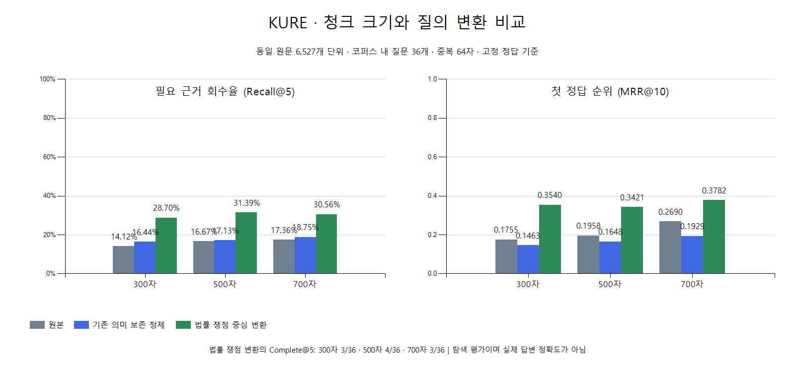

# 300·500·700자 비교 결과 해석

2026-10-20 완료. 같은 원문 6,527개 단위와 질문 100개·세 가지 입력·정답·질문 벡터를 고정하고 청크 크기만 바꿨다. 기존 300자 결과 300건을 재사용하고 500자와 700자에서 각각 300건씩 추가 검색했다. 문장형 법률 쟁점 변환을 단어 목록으로 바꾸지 않았다.

## 법률 쟁점 중심 변환의 비교

| 지표 | 300자 | 500자 | 700자 |
| --- | ---: | ---: | ---: |
| Recall@5 | 28.70% | 31.39% | 30.56% |
| Recall@10 | 38.29% | 38.75% | 38.06% |
| Hit@5: 정답 하나 이상 확보 | 18/36 | 20/36 | 20/36 |
| Complete@5: 필요한 정답 모두 확보 | 3/36 | 4/36 | 3/36 |
| 검색 1위가 고정 정답인 질문 | 9/36 | 8/36 | 10/36 |
| MRR@10 | 0.3540 | 0.3421 | 0.3782 |

이번 표본에서 500자가 근거 회수율과 근거 전체 확보율이 가장 높고, 700자는 첫 정답 순위가 가장 좋다. 500자와 700자의 Recall@5 차이는 0.83%p, 근거 전체 확보 문항 수 차이는 1개다. 큰 우열이나 운영 최적값으로 확정할 수 없다. 기존 선정 300자는 역사적 기준선으로 보존하고 새 청크를 서비스 설정에 적용하지 않았다.

300자 대비 500자는 Recall@5 +2.69%p, 700자는 +1.85%p다. 개별 질문을 보면 500자는 3개 개선·2개 악화·31개 동일, 700자는 2개 개선·34개 동일이었다. [문항별 대응 비교](paired-recall-changes.csv)에 보존했다. 청크 확대만으로 다수 질문의 누락 근거가 해결되지는 않았다.

## 세 입력 방식의 결과

| 문자 | 원본 Recall@5 | 기존 정제 Recall@5 | 법률 쟁점 변환 Recall@5 |
| ---: | ---: | ---: | ---: |
| 300 | 14.12% | 16.44% | 28.70% |
| 500 | 16.67% | 17.13% | 31.39% |
| 700 | 17.36% | 18.75% | 30.56% |

세 청크 모두에서 법률 쟁점을 표현한 입력의 고정 정답 기준 회수율이 가장 높았다. 이는 이번 고정 변환문의 탐색 효과이며 실제 서비스 LLM이 매번 같은 품질로 변환한다는 검증은 아니다. sparse 검색·KURE-v2·재정렬은 이번 실험에 추가하지 않았다.

## 고정 임계값의 점수 수용

| 법률 쟁점 변환 분류 | 300자 | 500자 | 700자 |
| --- | ---: | ---: | ---: |
| 코퍼스 내 | 23/36 | 23/36 | 22/36 |
| 추가 자료 필요 | 11/44 | 7/44 | 8/44 |
| 해외 관할·개인 사건 조회 | 2/15 | 2/15 | 2/15 |
| 핵심 사실 부족 | 1/5 | 1/5 | 1/5 |

기존 정제 임계값 0.59829341466087427을 세 크기의 법률 쟁점 변환에 동일하게 적용한 진단이다. 크기별 임계값을 다시 최적화하지 않았다. 점수 통과는 실제 답변의 정확성·근거 충분성·LLM의 범위 판단과 같지 않다. 다른 입력 모드의 수용률은 [전체 집계 CSV](comparison.csv)에 있다.

## 재현과 실행 확인

기존·신규 자료별로 원래의 공백 경계/고정 간격 정책을 유지하고 최대 크기만 바꿨다. 500자는 8,286개, 700자는 7,396개 청크이며 두 코퍼스를 다시 복원해 기존 원문·제목·출처·조문 ID가 모두 같은지 확인했다.

500·700자를 CPU 6개·메모리 8GB로 순차 실행했다. 새 문서 입력은 500자 1,206개·700자 680개였으며, 나머지 문서 벡터와 질문 벡터 300개를 재사용했다. 700자는 500자에서 생성한 동일 입력도 재사용해 사전 예상 최대 919개보다 적게 생성했다.

완료된 통합 900개 질문·9,000개 순위·36개 집계 행과 입력 해시를 확인했다. 코퍼스 내 36문항×세 입력×세 크기=324회에 대해 Recall·Hit·Complete·Precision·nDCG·MRR@10을 다시 계산해 원자료와 일치함을 확인했다. 별도 실행 검토의 범위와 근거는 [검토 기록](execution-check.json)을 따른다. KURE 컨테이너는 종료됐고 실험용 Qdrant 데이터는 보존했다.

질문셋은 이미 전략과 임계값을 탐색한 튜닝 자료다. 결과를 보고 같은 버전의 질문·정답·변환을 수정하지 않았지만 새 독립 held-out 검증은 아니다. 고정 정답 외 대체 근거 누락 가능성과 코퍼스 내 36문항의 작은 표본 한계를 유지한다. 답변 생성·실제 서비스 변환·추가 수집은 검증하지 않았으며 `serviceReady=false`다.

[원본 집계](README.md) · [고정 입력](../../../data/legal-query-chunks-v1/manifest.json) · [실행 계획](../../../review/legal-query-chunks-v1/README.md)
